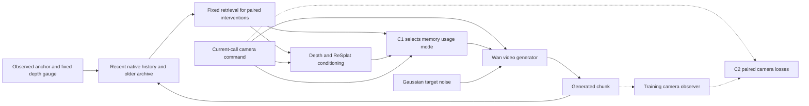

# Selective Visual Memory and Camera Control for Long Rollout World Models

**Research proposal · 10 October 2026 · Literature cutoff 10 October 2026**

We study camera-controlled video generation from one observed image in predominantly static environments. The central hypothesis is that a past image can remain useful for appearance even when its estimated geometric placement is unreliable. We propose to learn how that memory should be used and to train camera response separately from sensitivity to erroneous rendered conditioning. The experimental target is adaptation of a published Wan2.2-TI2V-5B model on one RTX 5090, with evaluation through 480 generated frames. The contributions below are hypotheses to be tested; no proposed performance improvement or training speedup is an established result. The first campaign develops one joint model with current-command-only runtime inputs; separate training ablations follow demonstrated long-rollout quality.

## Abstract

A historical view can preserve useful scene appearance while its estimated geometry supplies misleading spatial evidence. We study how a camera-controlled video model should use such a view: omit it, retain its native appearance, or also use its geometric conditioning. Our main candidate contribution is supervision of this usage decision by downstream generated-state consequences, complementing immediate predictive utility. A second, independently testable component adds paired command-response and geometry-disturbance regularization to absolute pose supervision. The runtime policy receives only past state and the current generation command. Robustness training begins in one joint teacher model, with refreshed own-state context, sparse two-call recovery, and qualified delayed preference labels; the same lineage then undergoes causal warmup and on-policy distillation. We first establish useful joint-model behavior through 480 frames, then run matched ablations to attribute the gains. Two-call utility measures downstream decision value; a separate history-evicted revisit audit is required for long-term archive mediation. Evaluation combines fixed-gauge camera tracking, scene-specific memory, visual quality, and failure coverage. Training on one RTX 5090 is a practical constraint; an efficiency advance requires a later matched quality-versus-total-cost comparison.

## 1 Introduction

Interactive scene generation requires a model to remember what it has shown and to move the camera according to the user's request. These requirements become coupled when the same historical images supply both appearance and reconstructed geometry. Suppose a generated room view contains the correct sofa texture, but its estimated depth places the sofa too close to the camera. Reprojecting that view can introduce excessive apparent motion. Discarding the view loses useful appearance; trusting its projection can corrupt both camera execution and later memory.

This proposal focuses on that conflict. We hypothesize that memory reliability should depend on its intended use: appearance support and geometric placement need not deserve the same decision. We further hypothesize that camera supervision should distinguish sensitivity to the requested motion from sensitivity to mistakes in the visual conditions. These hypotheses motivate C1, selective use of appearance and geometry, and C2, paired command-response and geometry-disturbance supervision.

The foundation is deliberately conventional: a pretrained video diffusion transformer, recent native latents, an archive of earlier latents, explicit camera conditioning, and target-view render tokens. Existing work already establishes important parts of this foundation. Our research question concerns what to trust when these conditions conflict and whether that decision improves camera tracking without sacrificing scene identity.

The intended contributions are:

1. **C1 — Learning memory-use decisions from their downstream consequences.** A three-mode interface preserves native appearance when geometric use is harmful. Immediate prediction loss provides a bootstrap signal; qualified generated-state preferences supervise subsequent utility. The main scientific test is whether delayed information improves decisions beyond immediate task cost and ordinary own-state training.
2. **C2 — Paired camera regularization under conflicting evidence.** Command changes and geometry disturbances provide matched examples for learning camera response. The claim requires gains over absolute pose supervision with the same generated samples, corruption and gradient exposure.
3. **Single-5090 training and a later efficiency study.** First demonstrate a strong joint model within measured resource limits. An efficiency contribution requires improved quality at matched total cost or reduced time to a fixed quality target; feasibility alone is insufficient.

On-policy training, long-term retrieval, pretrained depth, Gaussian rendering, and inference feedback are credited to prior work. The candidate training contribution is delayed credit for distinct memory-use modes under their own generated state transitions; starting own-state training earlier is not sufficient evidence of novelty. It is part of C1 and the joint C1/C2 training protocol, with separate falsification controls. A calibrated inference controller remains a secondary final-checkpoint experiment.

## 2 Related Work

### 2.1 Geometric conditioning and camera control

[GEN3C](https://openaccess.thecvf.com/content/CVPR2025/html/Ren_GEN3C_3D-Informed_World-Consistent_Video_Generation_with_Precise_Camera_Control_CVPR_2025_paper.html) conditions video generation on rendered views of a depth-derived 3D cache. [AC3D](https://openaccess.thecvf.com/content/CVPR2025/html/Bahmani_AC3D_Analyzing_and_Improving_3D_Camera_Control_in_Video_Diffusion_CVPR_2025_paper.html) analyzes camera information in diffusion transformers and uses those findings to improve conditioning placement and scheduling. They motivate our explicit geometry and camera pathways, which are shared foundation components rather than novelty claims.

[GeoStream](https://arxiv.org/html/2606.15162v1) is a particularly close neighbor: it refreshes geometry from generated frames and trains with self-generated geometric conditioning. Its local cache refresh addresses a different memory choice from retaining a long-lived native archive. Our proposed distinction is to separate the usefulness of archived appearance from the usefulness of its placement, while supervising camera response under conflicting conditions. This distinction still requires direct experimental evidence.

### 2.2 Memory for long scene exploration

[VMem](https://openaccess.thecvf.com/content/ICCV2025/html/Li_VMem_Consistent_Interactive_Video_Scene_Generation_with_Surfel-Indexed_View_Memory_ICCV_2025_paper.html) indexes stored views by observed surface elements. [WorldMem](https://proceedings.neurips.cc/paper_files/paper/2025/hash/470629a47e2d65ce0606c40055df5d26-Abstract-Conference.html) associates frames with states and uses state-aware memory attention. [Memorizon](https://arxiv.org/html/2610.00544v1) extends the training span while bounding the active memory bank and also describes Self Forcing distillation. [WorldCrafter](https://arxiv.org/html/2609.24984v1) queries an implicit 3D-aware representation using target poses; its selected readout is pose-guided. These methods establish retrieval, bounded active context, and camera-aware memory as strong baselines.

[Lyra 2.0](https://arxiv.org/html/2604.13036) uses per-frame geometry to route historical information while leaving appearance synthesis to the video model; it also trains on self-augmented histories. [GEAR](https://arxiv.org/html/2609.34722) separates visual memory from geometric addressing through correspondence attention and visibility filtering, and tests robustness to incorrect correspondences. Thus broad appearance/geometry separation and tolerance of bad matches are established. Our narrower question holds source identities fixed and learns a choice among usage pathways from the consequences of that choice.

[AlayaWorld](https://arxiv.org/html/2607.18367) combines temporal history, spatial memory, camera conditioning, and staged distillation. Its described cache and camera conditioning share the control trajectory as a pose source. This makes it relevant to the distinction between commanded and estimated realized pose in our secondary writing experiment; we do not attribute independent realized-pose writing to that method.

### 2.3 Learned utility and reliability

[FAR](https://arxiv.org/html/2609.34677v1) learns memory retrieval using predictive utility derived from diffusion losses. [Spatial Memory Intelligence](https://arxiv.org/html/2610.02521v1) includes reliability-aware filtering of generated chunks. These precedents rule out broad claims such as introducing learned memory utility or reliability filtering. C1 instead tests utility for different uses of a fixed source set. [GeoFlow](https://arxiv.org/html/2608.12203v1) studies geometry-aligned priors and uncertainty handling; consequently, learned render-based initialization is outside our main claim. The primary comparison starts from Gaussian noise.

### 2.4 Camera feedback and counterfactual supervision

[CamVerse](https://arxiv.org/html/2512.02870v1) uses estimated segment-relative camera motion as an online reinforcement-learning reward. [CamPilot](https://arxiv.org/html/2601.16214v1) uses a camera-aware latent-to-Gaussian decoder and reconstruction feedback. [OnlineWM](https://arxiv.org/abs/2609.23753) uses simulator-supported same-state action alternatives for causality-aware learning. Thus, pose feedback and action forks are established tools. C2 combines command-response supervision with invariance to erroneous rendered geometry under a controlled, shared state. Our arbitrary camera forks have pose targets but no corresponding recorded RGB target.

### 2.5 Exposure bias and evaluation

[Self Forcing](https://proceedings.neurips.cc/paper_files/paper/2025/hash/f4823f831af67a3ef15e41a85434422a-Abstract-Conference.html) trains autoregressive video diffusion using self-generated context and truncated gradients. We adopt this principle as part of the training foundation. Separately, the [memory-specificity audit](https://arxiv.org/html/2609.12090v1) shows why a benefit from memory does not establish dependence on the correct retrieved content. [R2M-Bench](https://arxiv.org/abs/2608.27328) motivates evaluating revisits relative to suitable controls. Our evaluation combines these concerns with explicit camera tracking so that reduced motion cannot masquerade as improved memory.

[Robust Dreamer](https://arxiv.org/html/2605.30855) explicitly models memory contamination through repeated write-and-recall cycles and uses a dynamic archive of model-generated deviations. [Wonder](https://arxiv.org/html/2607.26037) adds camera-aware adversarial regularization during causal distillation. These precedents cover error-feedback training and the connection between camera drift and visual collapse. Our candidate distinction is delayed supervision of a specific memory-use action, tested against immediate utility and matched corrupted-state training.

### 2.6 Comparison with the closest methods

The table summarizes published mechanisms and the question our experiments must address beyond them. It is a conceptual comparison, not a numerical leaderboard or proof that an unlisted capability is absent. Conference venues are listed only where verified; arXiv identifiers are publication references and do not imply acceptance.

| Method and publication | Relevant mechanism | Required distinction in this proposal |
| --- | --- | --- |
| [GEN3C, CVPR 2025](https://openaccess.thecvf.com/content/CVPR2025/html/Ren_GEN3C_3D-Informed_World-Consistent_Video_Generation_with_Precise_Camera_Control_CVPR_2025_paper.html) | Explicit cache rendered at requested views | Selective use under errors in the cache, beyond adding geometry |
| [AC3D, CVPR 2025](https://openaccess.thecvf.com/content/CVPR2025/html/Bahmani_AC3D_Analyzing_and_Improving_3D_Camera_Control_in_Video_Diffusion_CVPR_2025_paper.html) | Analysis-driven camera conditioning | Camera response when memory and render conflict |
| [VMem, ICCV 2025](https://openaccess.thecvf.com/content/ICCV2025/html/Li_VMem_Consistent_Interactive_Video_Scene_Generation_with_Surfel-Indexed_View_Memory_ICCV_2025_paper.html) | Surface-indexed view retrieval | Different uses of the same retrieved views |
| [WorldMem, NeurIPS 2025](https://proceedings.neurips.cc/paper_files/paper/2025/hash/470629a47e2d65ce0606c40055df5d26-Abstract-Conference.html) | State-aware frame memory | Preserve content while rejecting an unreliable placement |
| [GeoStream, arXiv 2606.15162](https://arxiv.org/html/2606.15162v1) | Refreshed geometry and on-policy distillation | Persistent native appearance plus selective geometric use |
| [Memorizon, arXiv 2610.00544](https://arxiv.org/html/2610.00544v1) | Long-span training and bounded retrieved context | Reliability under generated geometry errors, at matched context budgets |
| [WorldCrafter, arXiv 2609.24984](https://arxiv.org/html/2609.24984v1) | Pose-guided implicit-memory readout | Explicitly supervised appearance and placement alternatives |
| [AlayaWorld, arXiv 2607.18367](https://arxiv.org/html/2607.18367) | History, spatial cache, camera control, and staged training | Separate memory-use decisions; secondary uncertainty-aware writing test |
| [FAR, arXiv 2609.34677](https://arxiv.org/html/2609.34677v1) | Learned predictive retrieval utility | Utility for usage modes with source identities held fixed |
| [SMI, arXiv 2610.02521](https://arxiv.org/html/2610.02521v1) | Reliability-aware chunk filtering | Partial use of a source instead of only a retention decision |
| [CamVerse](https://arxiv.org/html/2512.02870v1) and [CamPilot](https://arxiv.org/html/2601.16214v1) | Camera reward or reconstruction feedback | Joint command sensitivity and resistance to render-induced motion |
| [OnlineWM, arXiv 2609.23753](https://arxiv.org/abs/2609.23753) | Same-state action counterfactuals with simulator support | Geometry-disturbance pairing without invented fork RGB labels |
| [Lyra 2.0](https://arxiv.org/html/2604.13036) | Geometry routing and self-augmented history | Supervised usage choices beyond separating geometry from synthesis |
| [GEAR](https://arxiv.org/html/2609.34722) | Correspondence attention and visibility filtering | Downstream usage utility beyond feature-based rejection of bad matches |
| [Robust Dreamer](https://arxiv.org/html/2605.30855) | Deviation archive for memory feedback errors | Delayed decision value beyond training with realistic deviations |
| [Wonder](https://arxiv.org/html/2607.26037) | Camera-aware adversarial distillation | Paired regularization beyond preserving camera fidelity during distillation |
| Proposed C1 and C2 | Selective memory use, delayed mode utility from the teacher stage, and paired camera supervision | Must beat immediate utility and ordinary own-state training, and transfer to natural long-rollout errors |

## 3 Problem Formulation

The runtime input is one RGB anchor, its cropped intrinsics, and camera commands revealed one generation call at a time. We target static or predominantly static scenes with intermittent dynamic content. Each continuation produces 16 RGB frames represented by four native video latents. The system maintains recent generated latents, an archive of older latents, geometric hypotheses for source views, and renderer metadata.

All runtime translations and depths share one fixed anchor-depth gauge. The anchor camera is the identity transform; one translation unit is the median valid predicted anchor depth before normalization. This gauge does not recover real-world metres or the arbitrary scale of registered cameras from one image. Later generated depth must be aligned to the existing gauge without rescaling the command trajectory.

Offline training annotations may use multiple recorded frames to fit a scale conversion. That is supervised label preparation. Runtime receives only past observations/state and the command for the current generation call, expressed in fixed anchor-depth units. Later-call commands, future RGB, future-derived geometry, and whole-path summaries are unavailable to the router, retrieval, render construction, and generator. An evaluation driver may store a full path but releases only the current-call slice. Recorded-path evaluation remains separately labeled as an offline-annotation diagnostic.

The desired behavior is to retain scene-specific appearance, execute the requested motion, and reduce the growth of errors across calls. Stable but stationary output is a failure when the command requests movement. Unobserved scene content remains a generative hypothesis, not verified geometry.

## 4 Proposed Method

### 4.1 Shared foundation and memory interface

We initialize from published [Wan2.2-TI2V-5B](https://github.com/Wan-Video/Wan2.2/blob/main/wan/configs/wan_ti2v_5B.py) weights and use 448 × 256 RGB frames. The packed image context is an anchor, up to eight recent native latents, up to six older native archive latents, zero or four target-aligned render latents, and four noisy target latents. Missing history is absent rather than copied. Stored generated latents are retained directly; the native archive does not require decoding and re-encoding its appearance.

Frozen depth models and [ReSplat](https://arxiv.org/abs/2510.08575) construct target-view conditioning from selected past views. A single source is passed to the two-view interface as two identical RGB, pose, depth, and confidence inputs. This is an interface adaptation and supplies one observation, not independent two-view evidence. We rebuild geometry from the selected sources rather than maintaining a permanently fused Gaussian map.

Camera rays, source roles, and renderer coverage/confidence have separate projections. Explicit age conditioning is removed; temporal positions still enter the original positional encoding. Target camera conditioning remains active regardless of whether memory or render is omitted. The active attention context is bounded, while archive storage and retrieval work can grow with rollout length; both costs must be reported.

The primary training arms use the same stage-specific writer and explicitly label source poses as commanded or estimated. A commanded pose is not silently treated as a measured realized pose. Changing to uncertainty-gated estimated-pose writing belongs to the separate final-checkpoint study.



### 4.2 C1 learns how to use a fixed memory set

We define three forced conditioning modes for the same selected archive sources:

| Mode | Archived appearance | Archive camera projection | Render tokens |
| --- | --- | --- | --- |
| Omit archive | Absent | Absent | Absent |
| Appearance only | Native latents retained | Entire projection output masked | Absent |
| Appearance and geometry | Native latents retained | Retained | Present |

The camera projection is bias-bearing, so appearance-only masks its complete output, including bias. Anchor, recent history, and target camera inputs remain fixed. Native spatial structure and temporal positions remain; this is not complete pose disentanglement. Geometry utility currently adds both source-camera conditioning and render tokens. To separate those effects, retain a forced diagnostic mode with native archive and source-camera projection present but no render. It is not a fourth learned router action in the first model. The anchor/history-only render control separately measures benefit unrelated to archived sources.

The first router uses spatially pooled source/current-context features, coverage/confidence and current target-view queries, followed by three logits for one bank-level choice per call. Balanced forced-mode exposure prevents early utility labels from reflecting only training imbalance. Later diagnostics estimate the advantage of per-state mode choice over the best fixed mode and whether runtime-visible inputs predict the choice, using separate seeds for selecting and scoring modes. Source-level gating is a later option only if mixed-quality banks expose a substantial limitation; it would also require admission before joint ReSplat construction, not just masking native camera embeddings.

Training evaluates mode costs using common target, noise, and diffusion time. A concrete initial utility proxy is the flow-prediction error under each forced mode:

```text
x_u = (1 − u) x_GT + u ε
ℓ_m = ||vθ(x_u, u; state, mode=m) − (ε − x_GT)||²
U_appearance = ℓ_omit − ℓ_appearance
U_geometry   = ℓ_appearance − ℓ_(appearance+geometry)
p*_m = stop_gradient[softmax(−ℓ_m / τ)]
L_C1 = cross_entropy(p*, router(state))
```

These are conditional pathway utilities. Flow-prediction utility is a bootstrap proxy; it must be checked against full-generation task costs before being trusted as their substitute. Report global and archive-exclusive supported-region performance separately. The joint model adds qualified combined task-cost preferences when available, with bootstrap and task-loss weights logged. Later attribution distinguishes diffusion-loss utility, immediate task cost E1, and delayed/combined task cost, using the same scored branches so that changing the metric is not mistaken for changing the horizon. No cost, target latent, or future command enters runtime router features.

The physical intervention grid crosses source appearance intact/corrupted with depth or pose intact/corrupted. Geometry interventions trigger actual rerendering. Source IDs, crop, intrinsics, history, target command, and noise remain matched. Synthetic interventions establish controlled behavior; self-generated states test transfer to natural errors. A useful result must preserve correct geometry's benefit and retain useful appearance under incorrect geometry, rather than learning to reject all render tokens.

### 4.3 C2 separates requested motion from geometry disturbance

Let P(Y) denote relative camera transforms estimated from a generated chunk by a frozen, differentiable RGB observer. Let Q(C) denote the requested relative transforms. All transforms use a shared prefix and fixed gauge. A robust SE(3) distance scores rotation and anchor-unit translation separately.

We construct two paired interventions:

1. **Command pair.** Keep history, archive, noise, and render fixed, or remove render in both branches; change the requested command. The observed difference should match the requested difference in direction and magnitude.
2. **Geometry pair.** Keep command, history, archive, and noise fixed; change the rendered condition by perturbing source geometry. The observed camera should remain consistent with the same command. Appearance itself need not be invariant.

```text
L_command = d_SE3(P(Y_a)⁻¹ P(Y_b), Q(C_a)⁻¹ Q(C_b))
L_geometry = d_SE3(P(Y_clean), P(Y_corrupt))
L_pose = Σ_j d_SE3(P_j(Y), Q_j(C))
L_C2 = λ_command L_command + λ_geometry L_geometry + λ_pose L_pose
```

The comparison uses matched local intervals and shared coordinates, not Euler-angle subtraction. Perfect absolute pose execution in every branch also makes the paired losses zero; they add a regularization hypothesis rather than a new observable camera quantity. The later pose-only comparator uses identical branch samples, corruption, observer calls, and comparable gradient exposure. Geometry-pair training uses the forced render-present geometry mode in both branches; evaluation reports both that fixed mode and free routing. Log actual render use after routing, since rejecting render can produce invariance without learning robustness while using geometry. Correct-render quality and visible motion remain guards against degenerate invariance.

Recorded-path pose and geometry losses can use a one-step denoising estimate, `x̂₀ = x_u − u vθ`, followed by differentiable frozen VAE decoding and the observer. The usable noise interval must be qualified on actual model estimates, including generated-prefix inputs. An arbitrary camera fork instead starts from shared Gaussian noise and uses a short sampler; it never receives the recorded future as RGB truth.

The initial fork proposal uses four denoising steps, gradients only through the final step, and one scene pair every eight generator updates. It is enabled only if that sampler produces observer-usable outputs. The implemented sequential gradient bridge uses ten generator forwards and two final-step backward graphs, with the generator graph and differentiable observer placed separately. A nine-forward variant requires their combined residency to fit. These counts exclude VAE, observer, conditioning and activation recomputation; they establish neither percentage overhead nor total VRAM reduction. Full sampler backpropagation is a separate ablation.

Ordinary scene rows and later matched controls share render dropout: initial probabilities are 0.5 for the first 100 updates and 0.25 thereafter. Pair branches share their dropout draw. Geometry-pair probes explicitly retain render and force the geometry mode in both branches; that qualified probe exposure is counted separately and matched by the later pose-only control. Loss frequency and gradient weighting are recorded.

### 4.4 Joint objective and gradient boundaries

```text
L_teacher_or_warmup = L_FM + λ_C1 L_C1 + λ_delayed L_delayed
                     + λ_C2 L_C2 + λ_boundary L_boundary
L_student_DMD      = L_DMD + qualified C1, delayed utility, C2, and boundary terms
```

Each term is applied only where its supervision is valid. Frozen model weights can still transmit input gradients: the final generated estimate must remain connected through the VAE and training observer. Earlier rollout chunks, geometry construction, discrete retrieval, pseudo-labels, and visibility masks are detached. We do not claim full long-horizon backpropagation.

On an own-state row that has diverged from its recording, the recorded future is not automatically a valid flow or C1 target. A qualified frozen teacher continuation from that same generated state, fixed before interventions, can supply a labeled pseudo-target. Until such a teacher is available, diffusion-target C1 utility uses only qualified recorded continuations. The delayed C1 route in Section 5.4 may instead use calibrated command error and trusted past-view correspondences when both are supported; this supplies a task-cost preference, not a future RGB label. Report per-loss eligible counts and fractions by call depth, command type, archive-exclusive support, and degradation severity. A few easy valid rows do not establish supervision of the states where collapse occurs; minimum useful coverage is fixed with calibration before activating each loss.

## 5 Training for Long Rollout Robustness

### 5.1 Three stages with shared contributions

The reference stage order is teacher adaptation, causal warmup, then on-policy distillation, as in [GeoStream](https://arxiv.org/html/2606.15162v1). Our robustness mechanisms begin in the teacher stage and remain active after causal conversion. Teacher denotes the model that will later supervise distillation; it does not require exclusively clean, teacher-forced context. Bidirectional attention is permitted within the current generated chunk, but rollout-state construction never consumes future recorded images. Update counts are starting references, not a compute-equivalent reproduction.

| Stage | Reference count | Training content |
| --- | ---: | --- |
| Teacher adaptation | 8,000 generator updates | C1/C2 and physical interventions from update 1; own-state collection after update 500; qualified two-call recovery and delayed mode utility within this stage |
| Causal warmup | 5,000 generator updates | Initialize from the robust teacher; validate causal attention and KV; refresh all own-state and utility labels; retain C1/C2, two-call recovery, and delayed utility |
| On-policy DMD | 1,000 reference steps | Current student generates context and geometry; real/fake scores provide distribution matching; retain qualified robustness auxiliaries and verify that distillation preserves teacher gains |

The DMD candidate explicitly uses 200 generator updates and 800 fake-score updates, totaling 1,000 optimizer events, following the counter interpretation reported by [Memorizon](https://arxiv.org/html/2610.00544v1). All three counters are logged separately. The implementation completed one real generator-plus-four-fake engineering event on one RTX 5090; full-stage quality and total campaign duration remain unqualified.

### 5.2 Early own-state collection and freshness

Collection starts after the first 500 main teacher updates, using the current generator in the new stock-model lineage. A causal student need not exist at this point. The pilot refresh interval is 500 generator updates; stage or sampler changes invalidate old replay eligibility. Historical adapted checkpoints and the earlier small technical pilot supply no training outputs or error labels.

The unbudgeted reference collection uses eight rotating, scene-balanced training scenes and seeds 7 and 11. The disabled executable candidate starts with two scenes and one seed each per refresh, plus a six-event delayed-label cap. Rollout depth grows from four calls, storing states after calls two and four, to ten calls from update 1,500, and twenty calls from update 2,500. These are unqualified starting settings; realized loss eligibility and exposure are logged. A bounded attention window does not make producing a long prefix free.

The proposed replay mixture is recorded-only through update 500, 90% recorded and 10% own-state through update 1,000, then 75% and 25%. Causal warmup uses refreshed states with the latter starting mixture. These are scene-row fractions; condition families and dropout are nested draws. Collection begins at update 500 even if some collected states are not yet eligible for particular losses.

Every full own-state row reconstructs recent latents, native archive, source geometry, render tokens, decoder prefix, and applicable KV state from the same generated history. The observed anchor remains allowed. Replacing only history while retaining clean recorded render is a separately labeled hybrid control. Snapshot replay becomes off-policy as weights change; exact on-policy rollout uses the current generator before its optimizer update. A long prefix initialized from an old replay state is also labeled hybrid.

### 5.3 Sparse two-call training

During teacher adaptation, after own-state qualification, one scene-row every eight generator updates is reserved for a two-call transition; the same mechanism continues in causal warmup and DMD. The first call is generated without gradients using the stage's actual sampler. The state and renderer are then updated exactly as in deployment. The second call receives C1/C2 and boundary supervision, with gradients through its final denoising step. No optimizer update occurs between the calls.

The boundary appearance term uses the training observer's estimated realized relative pose, detached from the loss graph. For camera-to-world estimates Ta and Tb, the source-to-target transform is inverse(Tb) @ Ta. Forward-warp low-pass RGB from the detached last frame of call one into the first new frame of call two using source depth and this estimated transform. Intrinsics, poses, and depth share the fixed anchor gauge; no command-based scale fit is allowed. Compare the warped source with low-pass target RGB only on qualified static, visible correspondences. The source, depth, warp coordinates, masks, and validity gate are detached; gradients flow only through the target image and its qualified decoder/sampler path.

Pose-command agreement across the boundary belongs to C2 and is counted once there. Detaching the appearance warp's pose copy must not detach C2's qualified observer gradient.

When inputs and qualification match, one frozen observer forward can serve both losses: call-one RGB is detached, while call-two RGB retains its input gradient. C2 consumes the original pose estimates; the boundary warp, support mask, and gate consume detached copies of every observer output they use. The boundary loss therefore retains its direct target-RGB gradient but has no gradient through the observer. Do not detach shared outputs in place, mask their gradients globally, or disable gradients around the shared C2 forward. A boundary-only observer forward may use detached inputs under no-grad. Separate forwards are an alternative when inputs or execution requirements differ, with their extra cost measured. Before activation, verify each loss's gradient path separately and check that their sum matches the combined target-RGB gradient.

If pose/depth is invalid, calibrated uncertainty is too high, or static support is insufficient, disable the appearance term for that row with a logged reason; never fall back to commanded-pose warping. Uncertainty uses calibrated same-video subset disagreement and observability, not agreement between different generator seeds. Report gate acceptance and failures by stage and call depth. Residual observer/depth bias can still affect this appearance-conditioned objective, so it is not perfect separation of camera and appearance errors.

```text
T_b_from_a = stop_gradient[inverse(Tb_c2w) @ Ta_c2w]
L_boundary = sum(M * ρ(B(Ib) − W(B(stop_gradient(Ia)), D_a, T_b_from_a, K))) / sum(M)
```

Here B is a fixed low-pass operator, W uses detached depth and z-buffered projection, M is a detached qualified visibility/static mask, and ρ is a robust appearance penalty. An empty mask skips the loss rather than becoming a zero-error success. The blur scale, support thresholds, uncertainty limits, and weight are fixed during calibration before activation.

A one-step estimate for the first call is an augmentation ablation unless deployment itself is a qualified one-step generator. Boundary joint denoising is also a separate ablation; it does not reproduce the state update between two actual calls. This training teaches continuation from imperfect state but cannot retroactively correct the detached first call.

### 5.4 Delayed utility through generated memory transitions

The candidate training contribution asks whether a memory-use decision remains beneficial after its output becomes future conditioning. An immediately sharp chunk can be a poor decision if a misplaced structure is written into memory and reinforced on the next call. Ordinary replay changes the input distribution, while the following probe explicitly supervises the earlier usage decision by its downstream consequences.

For a frozen snapshot and an eligible prefix, select a balanced pair among the three usage modes. Hold initial source identities, intervention, current command, anchor gauge and per-call noise fixed, and change only the first forced mode. Rebuild each branch's complete subsequent state from its own output, then generate call two with the same frozen continuation policy. That policy can choose different actions in different branch states; log these actions. E2 measures the resulting downstream policy outcome. With eight recent latents and four new latents per call, call-one output remains recent during calls two and three. Long-term native-archive mediation therefore requires a later diagnostic after history eviction, actual retrieval of the tagged source, and forced common-read or archive-interruption controls. Two-call labels alone do not establish that stronger claim.

Score both calls using calibrated command error and appearance on trusted static past surfaces, with reference provenance fixed before intervention. A divergent or forked rollout has no recorded-future RGB truth. Define the expected evaluable support from trusted geometry and the requested view before comparing outcomes, with conservative occlusion/uncertainty exclusions. Losing an expected surface in one branch triggers a calibrated failure/penalty or pair abstention; it must not silently shrink the winner's scoring region. Report both common-support appearance and lost-support fractions. Legitimate occlusion is not automatically a penalty. Keep command gain, naturalness and correct-geometry benefit as separate guards.

```text
E_m,h = w_pose e_pose(m,h) + w_app e_trusted_appearance(m,h)
J_immediate,m = E_m,1
J_delayed,m   = E_m,2
J_combined,m  = E_m,1 + γ E_m,2
J_m = J_combined,m for the first joint model; other costs are later ablations
q_a   = stop_gradient[sigmoid((J_b − J_a) / τ)]
L_delayed = binary_cross_entropy(sigmoid(logit_a − logit_b), q_a)
```

The first joint model uses combined task cost E1 + gamma E2, initially gamma = 1, once delayed labels qualify. Separate E1-only and E2-only training arms are deferred until the joint model demonstrates long-rollout quality. Record E1 and E2 from the same matched branches throughout, including preference reversals and differences above calibrated score noise; this logging does not require separate trained models. E2 includes consequences of first-chunk quality and does not isolate pure long-term archive mediation. Pair sampling covers all three mode pairs. Probe generation, geometry, and costs are detached; labels train the earlier router decision while second-call C2/boundary losses train backbone recovery. After joint-model success, report downstream decision regret of the immediate selector against independently scored combined-cost choices, in addition to preference reversals. Select and evaluate choices with disjoint noise replicates; a stable E2 difference alone is not evidence that delayed information improves decisions.

Offline snapshot labeling is the default. At each 500-update own-state refresh, checkpoint and pause training, release training-model/optimizer GPU residency, and generate both branches using that same frozen snapshot. Place the generator, VAE, geometry estimator, renderer, and observer sequentially as needed; serialize state and restore training afterward. The router consumes cached labels and matching snapshot states with logged staleness. Count generation, geometry, observation, I/O, and reload costs. A two-branch, two-call event with a 30-step teacher nominally requires 120 denoiser evaluations before reuse and CFG expansion. The former every-64-update inline probe is disabled unless separately qualified for memory and time. The live two-call recovery path also needs its own sequential-residency profile; offline labeling does not make it free.

Delayed labels record both branches' checkpoint, sampler, state, source, command, noise, score support, and errors at each call. They expire with own-state freshness and stage-change rules. The first decision receives only available past state and the current command; the second command is revealed only at the second call. Offline labeling samples that next-call trajectory from a frozen, training-only empirical command distribution, with scene-balanced sampling and shared draws across the mode pair. Its manifest, gauge conversion, weights, and seed are logged. Per-draw soft preference labels teach expected pairwise preference over this command distribution and generation noise, not the hindsight-optimal choice for a particular hidden future. Expected combined task cost is the evaluation criterion; averaging sigmoid preferences is not claimed to equal applying a sigmoid to mean cost differences. Repeatability tests hold the sampled next command fixed across their noise seeds; command variation is reported separately. No future-command identifier, suffix, or score enters router features. Improvement must transfer to natural errors at 10, 20, and 30 calls.

Before enabling delayed supervision, run a development-only screening panel of 20 fixed rows with seeds 7, 11, and 19. Each row fixes a scene, prefix, and mode pair; branches share noise at both calls. Use the paired statistic Delta2(i,s)=E2(A)-E2(B), and report |mean_seed Delta2| divided by max(sample_std_seed Delta2, calibrated score-noise floor). A ratio above two is a screening heuristic, not statistical proof with three seeds; low-ratio rows abstain or receive prebudgeted extra seeds. Report sign stability, practical effect above observer noise, eligible-label fraction, mode-win balance, and failures. The panel costs 240 chunk generations for one pair per row, nominally 7,200 denoiser evaluations with the 30-step teacher, before other costs; testing all three pairs per row would triple it. Four-step labeling is permitted only after that sampler is qualified.

The train v2 index provides an inexpensive archive-exclusive frustum proxy, not measured surface visibility. Development candidates must come from a separate development-only audit. Prioritize high-proxy rows, then validate actual static visible archive-exclusive support on each generated state; retain broad training coverage and separate low-support diagnostics. Development outputs serve selection and reporting only and never become router or generator labels. The full-stream camera-scale statistic in this audit is an offline diagnostic and cannot enter runtime scale calibration.

Own-state collection starts after teacher update 500; delayed loss activation additionally requires support masks, generated-domain observer calibration, the paired repeatability screen, pipeline profiling, and fresh training-only labels. Updates 1,000–2,000 are a planning range, not a measured start date or a rule requiring the second refresh. Log the actual activation update. If the gates do not pass within the teacher budget, revise the claim explicitly. The historical DINO change 0.370 to 0.846 came from joint recorded-history/evidence substitution in a frozen single-chunk diagnostic; it is not evidence for delayed utility or committed rollout recovery.

### 5.5 Why the training addresses long rollout failure

C1 targets harmful geometric reuse while retaining appearance. C2 targets camera drift when rendered evidence conflicts with the command. Full own-state training exposes both mechanisms to the feedback loop created by generation, geometry estimation, and memory reuse. The two-call row teaches continuation from an imperfect transition; delayed mode utility additionally teaches which earlier memory decision reduced the next call's error. Both begin in teacher adaptation, while increasing harvested rollout depth exposes later failure states. Ordinary own-state and boundary training remain necessary shared controls. These mechanisms do not guarantee recovery of unobserved geometry, elimination of color drift, or arbitrary-horizon stability; the long evaluation is required to determine their limits.

## 6 Adaptation on One RTX 5090

The initial trainable set contains all self-attention layers, the stock patch embedding, camera/metadata/role projections, and the new C1 router. Remaining backbone parameters, including FFNs, text cross-attention, time modules, and the output head, are frozen. Preparation models are frozen. Trainable weights are FP32 and computation uses BF16 where supported. This is selective adaptation rather than full-model training or LoRA; LoRA is a required matched efficiency baseline.

Existing new camera, metadata, and role projections use a truncated normal with standard deviation `1 / sqrt(3072) ≈ 0.01804`, truncated at three standard deviations, and zero biases. The weights are small random values rather than all-zero tensors. Pretrained weights are preserved. The router will also use a nonzero initialization whose activation scale is checked in the pilot.

At the single-chunk maximum, 23 image latents produce 2,576 image tokens after the stock spatial patching, excluding text. Multi-target teacher training can exceed this count and needs its own memory profile. Pre-encoded VAE/text features, bounded active memory, activation checkpointing, a suitable optimizer-state representation, and sequential probe evaluation are engineering tools to be measured rather than independent algorithmic contributions.

Naively retaining three 5B models for DMD requires about 30 GB of BF16 weights alone, before trainable FP32 copies, gradients, optimizer state, activations, and observers. We must validate sequential placement, offload, and any sharing of genuinely identical frozen weights on the available host. Teacher, student, and fake-score trainable weights are distinct. GPU memory, host RAM, transfers, and geometry-model residency are part of the feasibility test.

The primary efficiency axes are quality versus total RTX 5090 hours and time to a fixed quality target. Report training-core time and complete pipeline time separately, including preparation, refreshed own-state, teacher/fake-score work, observer calibration, rerendering, and evaluation. Report peak allocated/reserved/device memory, RAM, trained parameters, target-frame exposure, and throughput. Common preparation costs are shown both once for the actual campaign and in the cost of a standalone reproduction. An inference speedup does not establish training efficiency.

## 7 Data and Experimental Protocol

### 7.1 Scene splits and sampling coverage

The local corpus is drawn from DL3DV recordings, deduplicated across resolution copies and split into contiguous streams without joining missing intervals. The current inventory contains 8,732 eligible training scenes, 128 development scenes, and a separate locked set of 24 test scenes. Sixty historical evaluation scenes are excluded from the new training pool. Physical-location near-duplicates are not yet certified; a cross-split duplicate audit is required before a strong generalization claim.

The sparse plan selected 9,159 of 703,474 possible training continuation starts, about 1.30%. The dense manifest selects 190,778 starts, about 27.12%, and its union of target-frame positions covers about 99.41% of the available positions. Coverage of positions does not mean every sliding start is sampled or that every example has reached the optimizer. The dense manifest is not evidence that all render caches are materialized. An audited ready subset may support the initial phase, with transitions to denser coverage versioned and matched across arms.

Sampling remains scene-balanced so longer recordings do not dominate. Captioning is anchor-only. No development or test output becomes a training donor. Each generated state records its producer checkpoint, stage, sampler, seed, commands, source identities, gauge, rollout depth, and validity for each loss. All arms share the same split and representation preparation wherever the mechanism permits.

### 7.2 Controlled interventions and observer qualification

Before enabling camera losses in the joint run, qualify the real decoder/observer path on recorded controls, VAE round trips, known-geometry degradations and checkpoint-specific one-step estimates. The initial noise scan uses u in {0.20, 0.35, 0.50, 0.65, 0.80} with shared seeds. Measure signed gain, bias, local RPE, wrong-direction rate, failures and input-gradient behavior. A small parameter update through the training observer must improve an independent geometric measurement, not merely its own score. These are correctness checks within joint-model development, not a requirement to train comparative ablation arms first.

The first training-observer candidate is frozen DA3 through a gradient-enabled core forward, subject to implementation and VRAM qualification. It receives RGB, intrinsics and trusted past reference information, never the requested trajectory as pose evidence. Map its predicted reconstruction to fixed anchor-derived 3D support, using only already available observations; detach the gauge-registration transform while retaining the qualified image-to-pose gradient. Anchor-depth landmarks with correspondence-based PnP provide a separate reference-supported scale check. After the anchor leaves view, propagate the gauge only through verified overlapping landmarks; otherwise report translation unavailable. ViPE is the independent evaluation-observer candidate, also subject to gauge and coverage qualification. Neither backend agreement nor alignment to the desired trajectory establishes accuracy. Calibration reports observability and failures by motion, overlap, degradation and rollout depth; no named backend is considered qualified merely by this selection.

### 7.3 Long rollout evaluation

Every 500 generator updates, the fixed ten-scene development panel produces one 480-frame rollout per anchor with seed 7. The 160-, 320-, and 480-frame results are prefixes of that same rollout, with no bank reset or resampling. The first 160 frames of the mixed command path match the previous monitor. Later segments include delayed returns; a separate continuous-forward path tests exploration without relying on return cancellation. Stage-end evaluation covers all 128 development anchors, reusing identical monitor outputs. Final paired comparisons include seed 11.

The development inventory contains 63 scenes with at least 321 recorded frames and none with 481; the longest encoded stream has 437 frames. Anchor-only runtime tests can still generate 480 frames because their controls are explicitly defined in anchor-depth units. Such paths have no paired future RGB, so we do not report recorded-reference PSNR or LPIPS for them. Recorded-path metrics use only available full chunks and retain the offline-calibration label.

| Evaluation axis | Primary measurements | Failure that the measurement must expose |
| --- | --- | --- |
| Camera execution | Local rotation/translation RPE, response gain, endpoint error, error growth | Under-travel, wrong direction, render-driven drift |
| Scene memory | Revisit identity relative to non-revisit controls; read-time substitutions | Generic support mistaken for specific memory; frozen motion |
| Temporal quality | Boundary discontinuity, supported chroma/structure drift, sharpness and naturalness | Smooth accumulation of wrong color or structure |
| Reliability | Observer failures, missing translation scale, first failure call, valid overlap | Survivor-only averages and hidden measurement collapse |
| Efficiency | Quality versus total GPU hours; time to target; memory and exposure | Lower cost caused by easier resolution, shorter horizon, or omitted work |

Use a fixed coordinate system throughout a rollout. No per-window, per-horizon, or full-path alignment is allowed to absorb command error. A common-first-call alignment diagnostic may be reported separately, with its constant-gain ambiguity stated. Confidence intervals are computed over paired scenes, not independent frames. Tolerances and failure definitions are frozen on calibration/development data before test evaluation. The later primary comparison is joint B3 versus matched foundation B0, with whole-trajectory local translation/rotation tracking and revisit identity as co-primary outcomes under motion and coverage guards. Freeze thresholds and the multiplicity rule from development data. Endpoint error alone is insufficient on returning paths: a CPU check of the mixed path shows that freezing after frame 160 can still yield zero frame-480 position error. Seeds are nested within scenes; 24 scenes with two seeds are not 48 independent scenes.

### 7.4 Memory specificity and camera intervention tests

At a selected read in a frozen prefix, compare correct archive content, wrong place from the same past trajectory, a disjoint training-scene donor, a training-only identity-free prototype, and zero content with fixed slots. True archive absence is a separate reference. Preserve slot metadata and the router decision for the direct-path audit; evaluate router adaptation separately. Native token substitution may change internal attention queries and keys, so it is not described as a fixed-QK value intervention. The appearance-only audit omits render to prevent duplicated content from bypassing the substitution.

Camera forks share state and noise and include correct, wrong, fixed, and absent-render conditions as appropriate. Report whether the observed response has the correct sign and amplitude, as well as local error and visual quality. Revisit gains accompanied by reduced executed motion fail the main hypothesis. Natural generated errors are reported separately from synthetic corruption severities.

## 8 Comparison and Ablation Plan

### 8.1 Joint model first and later matched comparisons

The first campaign trains one joint model, B3, with C1, qualified C2, own-state training, two-call recovery, and qualified combined delayed utility. Engineering checks establish correct masking, current-command isolation, scale, useful gradients, label validity, and measured memory/time before their corresponding path is enabled. They do not require separate trained ablation arms or a prior proof of each contribution. The same lineage proceeds through teacher adaptation, one causal warmup, and one on-policy DMD pass, subject to stage quality retention; preserve each working checkpoint. Evaluate the joint model on development trajectories through 480 frames, with camera motion, scene retention, naturalness, and failure coverage assessed together. Only after useful long-rollout behavior is demonstrated do the B0/B1/B2 controls and focused training ablations begin. The table below defines that deferred study.

| Arm | C1 | C2 | Main question |
| --- | --- | --- | --- |
| B0 Shared foundation | Off | Off | What do memory, geometry, dropout, and own-state training already achieve? |
| B1 Selective memory | On | Off | Does usage selection improve content retention under geometry error? |
| B2 Paired camera training | Off | On | Does paired supervision improve control under conflicting render? |
| B3 Joint method | On | On | Are the gains complementary and retained over long rollout? |

After joint-model success on development data, compare C1 against always-appearance, always-geometry, no-archive, and a single confidence gate; compare C2 against pose-only and command-pair-only objectives with matched generated samples, corruptions, observer exposure, and dropout. Keep recorded-only and ordinary own-state plus boundary controls. The later utility study has E1-only, E2-only, and combined-cost arms using matched branch records and score components. Branch generation used to train the first router is part of its supervision, not a requirement to train these ablation arms in advance. Run later teacher controls from the same original initialization and recipe; toggling a component off on the final checkpoint is only an inference diagnostic. Teacher-stage attribution does not establish the same causal effect in the distilled model without a matched control through the later stages. These later runs receive a separate, explicitly measured budget.

The first campaign prioritizes joint-model quality on one RTX 5090 and records complete pipeline cost. After it succeeds, scientific ablations match example exposure, and the efficiency study separately matches total 5090 hours. The later LoRA comparison uses the same backbone, inputs, resolution, data, and objective, with a stated capacity-selection budget. Methods receive no uncounted own-state harvest or teacher service. Hardware feasibility alone does not establish an efficiency improvement.

### 8.2 External methods and fair scope

Audit compatible released checkpoints of Lyra 2.0, GEAR, Robust Dreamer and Wonder alongside GeoStream, Memorizon, VMem, GEN3C and WorldCrafter as external comparison candidates. Availability, licensing, conditioning and evaluator compatibility determine executable rows; the mechanism table is not a promise to retrain every method. Local adaptations are labeled as reproductions. External evaluation and trained ablations follow the first successful joint-model development run.

External inference comparisons share anchor images, requested paths, output horizon, and supported camera units. Report each model's native resolution, sampler, context budget, and any command conversion. Do not silently equate a continuous pose path with a coarse discrete action sequence. Compare author-reported native performance separately from measurements obtained under our protocol. Training cost cannot be ranked by GPU count alone across different accelerators, datasets, or pretrained backbones.

### 8.3 Planned result tables and figures

The paper should contain: a matched foundation/C1/C2/joint table; a physical-intervention and natural-error table; a read-time memory-substitution table; camera and quality curves at 10/20/30 calls; a teacher-stage immediate-versus-delayed utility table with retention through causal/DMD stages; a quality-versus-5090-hours plot with a LoRA baseline; and one optional final-checkpoint controller table. Qualitative sequences show both early and late frames, the requested and estimated path, and failures selected by a fixed sampling rule. No numerical result is filled before the corresponding experiment is completed. The planned headline figure holds archived content and commands fixed, shows how bad placement changes the preferred usage mode, and follows the resulting camera/identity trajectory through a later revisit. It must display actual motion and failures alongside visual similarity; any archive-mediation panel additionally verifies history eviction and source readback.

## 9 Secondary Inference Study

After the final C1/C2 checkpoint passes a camera-response test, evaluate a calibrated controller that replans from the estimated current pose to the next desired waypoint. Keep desired pose, actual model command, and estimated realized pose as separate records:

```text
ξ_goal = Log(T̂_k⁻¹ T*_(k+1))
estimated local response ≈ A u + b
```

Fit a small, regularized response model only in observable, controllable directions, after calibrating observer bias. Bound correction magnitude and change. Apply the resulting trajectory consistently to target rays and render; do not move source poses merely to increase actuation. Reliable estimated pose can support geometric writing in the fixed gauge. When geometry is uncertain, preserve native appearance and defer geometric admission.

Uncertainty is approximated by disagreement between two subsets of the same completed video, with shared anchor/endpoints and no independent scale fitting. Different generated seeds are not an observer-uncertainty estimate. The controller is tested on waypoint tracking; stop or joystick commands do not authorize catch-up motion toward an abandoned waypoint.

The six-row ladder is open loop, calibrated fixed gain, bounded proportional correction, calibrated replanning, replanning with estimated-pose writes, and the same writes with uncertainty gating. All rows use one frozen generator. [Feedback World Model](https://arxiv.org/abs/2605.15705) already establishes inference feedback with real observations in a different setting; our generated RGB is not an independent physical sensor, and generic closed-loop control is not a novelty claim.

Low-frequency color registration and two-candidate verifier selection remain optional final-checkpoint ablations. Their costs are measured, and selection must not use the held-out evaluation observer. Depth-head writing, source-credit accumulation, two-pass retrieval, learned flow initialization, and boundary joint denoising remain outside the core proposal. They are added only if a measured residual failure justifies the extra scope.

## 10 Success Criteria and Risks

The central hypothesis is supported only if useful archived appearance survives geometry corruption, command response improves with wrong or missing render, and both effects transfer to natural self-generated errors without a practically meaningful loss of correct-render quality. Gains must persist with the optional controller and candidate selection disabled. Statistical significance alone is insufficient; improvement must exceed the observer's calibrated noise and the preregistered practical threshold.

The main risks are observer bias and reward exploitation; insufficient four-step output quality for the proposed gradient route; a router that always rejects geometry; noisy pseudo-utility labels; own-state errors outside synthetic intervention coverage; and a one-card DMD schedule whose transfers dominate compute. Additional risks include dynamic content, view-dependent appearance, and cross-split near-duplicate locations. The corresponding controls are independent evaluation, known-geometry calibration, simple routing baselines, full-generation audits, natural-error strata, and explicit end-to-end resource measurement.

If C1 does not outperform a single confidence gate or always-appearance use, its added architecture is not justified. If C2 cannot improve camera response beyond shared dropout and pose-only supervision, the paired objective is not supported. If single-card training is feasible but loses at equal quality and cost, report feasibility rather than an efficiency advance. If delayed utility does not improve long-rollout error growth over immediate utility and ordinary own-state training at matched cost, no long-rollout training novelty is claimed. If on-policy distillation erases the teacher's C1/C2 or robustness gains, it fails stage qualification and the narrower validated scope must be reported.

## 11 Implementation Milestones

| Milestone | Deliverable and exit condition |
| --- | --- |
| M0 Data and controls | Audit caches and physical interventions; enforce past-state plus current-command input boundaries |
| M1 Working joint implementation | Implement C1/C2; qualify scale, decoder/observer gradients, support and forced-mode operation |
| M2 Single-model resource profile | Measure the joint teacher, enabled rollout/label paths and monitoring; set a finite first-run budget |
| M3 Joint teacher training | Train one B3 model; collect own-state after update 500 and enable combined delayed utility when labels qualify |
| M4 Joint deployment model | Continue the same lineage through causal warmup and on-policy DMD with stage quality checks and preserved checkpoints |
| M5 Development quality decision | Demonstrate useful 160/320/480-frame behavior without future-command access; fix a weak model before allocating ablation runs |
| M6 Attribution and final evaluation | After success, run separately budgeted matched ablations; freeze settings before locked-test evaluation |

The first model and later ablations have separate budgets:

```text
T_first = T_shared_preparation + T_calibration
        + T_joint_teacher + T_own_state_and_offline_labels
        + T_joint_causal + T_joint_DMD + T_development_evaluation
T_later = T_matched_ablations + T_final_evaluation + T_optional_controller
```

Each term is counted once; embedded rollout/probe costs are not added again. The initial allocation is for one joint lineage, including own-state harvesting, labels, observers, and development evaluation. Set a positive numeric budget from measured costs before launch; 8k/5k/1k remain reference counters. Checkpoint at the recorded time or update cap and use development evidence for any subsequent extension. Ablation budgets are assigned only after the joint model shows useful long-rollout behavior. Locked-test scenes are reserved for the later frozen comparison, not the decision to continue model development. Under the 8k-update, 30-step reference schedule, periodic monitoring costs 144,000 denoiser evaluations for the one teacher, plus 106,200 incremental stage-end evaluations after reusing ten scenes. These are operation counts, not measured hours. Profile the monitoring schedule and set a per-refresh label-event cap before launch; no ablation-arm evaluation multiplier belongs in the initial one-model allocation.

## References

1. [GEN3C: 3D-Informed World-Consistent Video Generation with Precise Camera Control](https://openaccess.thecvf.com/content/CVPR2025/html/Ren_GEN3C_3D-Informed_World-Consistent_Video_Generation_with_Precise_Camera_Control_CVPR_2025_paper.html). CVPR 2025.
2. [AC3D: Analyzing and Improving 3D Camera Control in Video Diffusion Transformers](https://openaccess.thecvf.com/content/CVPR2025/html/Bahmani_AC3D_Analyzing_and_Improving_3D_Camera_Control_in_Video_Diffusion_CVPR_2025_paper.html). CVPR 2025.
3. [VMem: Consistent Interactive Video Scene Generation with Surfel-Indexed View Memory](https://openaccess.thecvf.com/content/ICCV2025/html/Li_VMem_Consistent_Interactive_Video_Scene_Generation_with_Surfel-Indexed_View_Memory_ICCV_2025_paper.html). ICCV 2025.
4. [WorldMem: Long-term Consistent World Simulation with Memory](https://proceedings.neurips.cc/paper_files/paper/2025/hash/470629a47e2d65ce0606c40055df5d26-Abstract-Conference.html). NeurIPS 2025.
5. [Self Forcing: Bridging the Train-Test Gap in Autoregressive Video Diffusion](https://proceedings.neurips.cc/paper_files/paper/2025/hash/f4823f831af67a3ef15e41a85434422a-Abstract-Conference.html). NeurIPS 2025. [Technical method](https://arxiv.org/html/2506.08009v1).
6. [GeoStream: Toward Precise Camera Controlled Streaming Video Generation](https://arxiv.org/html/2606.15162v1). arXiv:2606.15162.
7. [Memorizon: Training World Models Beyond Their Context Window](https://arxiv.org/html/2610.00544v1). arXiv:2610.00544.
8. [WorldCrafter: Consistent Video World Model with Implicit 3D-aware Memory](https://arxiv.org/html/2609.24984v1). arXiv:2609.24984.
9. [Learning What to Recall: Adaptive Multi-Cue Episodic Memory for World Models](https://arxiv.org/html/2609.34677v1). FAR, arXiv:2609.34677.
10. [Spatial Memory Intelligence: Endowing World Models with Understanding-Driven Long-Term Memory](https://arxiv.org/html/2610.02521v1). arXiv:2610.02521.
11. [GeoFlow: Efficient Driving Video Generation via Geometry-Aligned Priors](https://arxiv.org/html/2608.12203v1). arXiv:2608.12203.
12. [Taming Camera-Controlled Video Generation with Verifiable Geometry Reward](https://arxiv.org/html/2512.02870v1). CamVerse, arXiv:2512.02870.
13. [CamPilot: Improving Camera Control in Video Diffusion Model with Efficient Camera Reward Feedback](https://arxiv.org/html/2601.16214v1). arXiv:2601.16214.
14. [OnlineWM: Causality-Aware Active Online Learning for Effective World Modeling](https://arxiv.org/abs/2609.23753). arXiv:2609.23753.
15. [Does Video Memory Use What It Retrieves? A Causal Audit of Memory Specificity](https://arxiv.org/html/2609.12090v1). arXiv:2609.12090.
16. [R2M-Bench: Evaluating Revisit Memory via Relative Consistency in Interactive Video World Models](https://arxiv.org/abs/2608.27328). arXiv:2608.27328.
17. [Feedback World Model Enables Precise Guidance of Diffusion Policy](https://arxiv.org/abs/2605.15705). arXiv:2605.15705.
18. [ReSplat: Learning Recurrent Gaussian Splatting](https://arxiv.org/abs/2510.08575). arXiv:2510.08575.
19. [Wan2.2 official TI2V-5B configuration](https://github.com/Wan-Video/Wan2.2/blob/main/wan/configs/wan_ti2v_5B.py). Backbone specification; our adaptation and sampler choices are separately defined above.
20. [AlayaWorld: Interactive Long-Horizon World Modeling — Full Technical Report](https://arxiv.org/html/2607.18367). arXiv:2607.18367.
21. [Lyra 2.0: Explorable Generative 3D Worlds](https://arxiv.org/html/2604.13036). arXiv:2604.13036.
22. [Geometry as Address: Routing Attention to Visual Memory for Long-Horizon Camera-Controlled Video Generation](https://arxiv.org/html/2609.34722). arXiv:2609.34722.
23. [Robust Dreamer: Deviation-Aware Latent Gaussian Memory for Action-Controlled AR Video Generation](https://arxiv.org/html/2605.30855). arXiv:2605.30855.
24. [Wonder: Video World Model Done Better](https://arxiv.org/html/2607.26037). arXiv:2607.26037.

## Appendix Implementation Traceability

The current research specification is [contribution contract v9](../../training_runs/base_restart_20261008/dataset_v3/review_20261010/contribution_contract.proposed.json), with [long-rollout commands and development protocol](../../training_runs/base_restart_20261008/dataset_v3/review_20261010/long_rollout_dev.proposed.json). The research history and underlying qualifications are in [REDESIGN sections 12 to 19](REDESIGN.md). Dataset numbers come from the [dataset specification](../../training_runs/base_restart_20261008/dataset_v3/dataset_spec.json), [dense-start audit](../../training_runs/base_restart_20261008/dataset_v3/review_20261010/dense_round0_stride4.json), and [target-position coverage audit](../../training_runs/base_restart_20261008/dataset_v3/review_20261010/dense_round0_coverage.json).

The joint implementation now includes C1 routing with output-level archive camera masking, C2 observer-gradient transfer, snapshot replay and offline delayed-label consumers, detached two-call boundary supervision, chunk-causal conversion, real/fake-score DMD, and a 160/320/480-frame driver. Eighty CPU tests passed, including future-command-suffix invariance. A new 64-group dataset produced 256 physical variants in 1,040.8 seconds, including native appearance and packed-ray interventions. Source/tensor factorization passed; static visible support remains unqualified. Thirty-three groups contain archive sources.

Actual 5B RTX 5090 probes reached 20.84 GiB for six-archive, 23-latent base-training events, 20.28 GiB for C2 gradient transfer, and 18.25 GiB for one DMD generator-plus-four-fake event. These are component measurements, excluding a complete production schedule. One uninterrupted 480-frame engineering rollout with a 30-step sampler and independent ViPE evaluation completed in 340.4 seconds. It used untrained joint weights, a training anchor and a path with no archive selected; it is neither a donor nor learned memory/control evidence.

The decisive unresolved gate is camera qualification. A fixed-reference PnP panel covering 20 training scenes at each of three noise levels passed no complete threshold set. At u=0.15, translation-error p90 was 0.0364 anchor units against a 0.03 limit, and independent gradient acceptance was 25% against 60%. At u=0.35, acceptance among valid rows was 77.8%, but 55% of rows lacked valid measurements. Reference RGB/pseudo-depth entered only the offline evaluator, not runtime or the training observer; thresholds were not relaxed.

Main training remains disabled. Generated-state support and labels, full-stage behavior, dev naturalness/identity and the complete campaign budget remain unqualified. See the [current issue-by-issue report](../../training_runs/base_restart_20261008/dataset_v3/review_20261010/joint_v9_implementation_resolution.json). Protected historical checkpoints and their dependencies remain unchanged.
