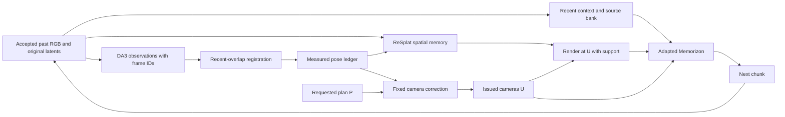

# GaussVerse design after the generated-history and reset tests

5 November 2026. This is the current design decision. It supersedes the earlier
2Xplat-first architecture and feedback-first training schedule in this directory.
It is a specification, not a launched run or a claim of demonstrated improvement.
Existing queues, protected weights and rejected experiment artifacts are preserved.

## 1. What the new evidence establishes

| Evidence | Verified reading | Design consequence |
| --- | --- | --- |
| Command/render probe, 10 scenes | First-call execution ratios: normal 0.9614, blank render 1.0078, static cameras 0.4926, static render 0.2791. First-call VGGT rotation: normal 1.6123 degrees, blank 7.2434 | Camera conditioning is active; render conditioning strongly affects motion and appearance. These are interventions, not linear mixing coefficients or differential gains. Preserve both inputs and train recovery from unreliable renders. |
| Recorded-view 2Xplat gate | Mean PSNR 17.696 versus ReSplat 16.749, 7/10 wins | Clean recorded views alone did not predict deployment behavior. |
| Generated-history renderer comparison | Same DA3 poses and three sources, common-support PSNR: 2Xplat 15.109 versus ReSplat 18.212. With eight coverage-selected sources: 16.081 versus 18.039 | Keep DA3 + ReSplat. 2Xplat loses the tested aggregates, not literally every scene; no reason to train the generator around it now. |
| Sequential registration on recorded views | Anchor-only position 0.0292; L4o 0.0152. Boundary/within-call steps become 0.0028/0.0028 | Recent-overlap registration is a concrete candidate fix; orientation alignment avoids relying on poorly conditioned camera-center geometry for rotation. |
| Sequential registration on generated views | Wo position versus plan 0.1844 to 0.0923, but versus VGGT 0.3709 to 0.4084; L4o gives 8/10 LPIPS wins, mean 0.5495 to 0.5364 | Wo is not yet proven the most accurate observer. Prioritize L4o qualification and keep Wo as a matched alternative. Never select registration by agreement with commanded motion. |
| History reset at RGB frame 160, six scenes | LPIPS and DINO improve on all six scenes in all four subsequent bins; last-bin LPIPS 0.5496 to 0.4938 | A clean state improves continuation, but the model deteriorates again. Train recovery from the states encountered during rollout. |

The sequential long-fit experiment uses **40 sampled generated images from a
160-RGB-frame rollout**, plus the anchor; it is not a 40-consecutive-frame test.
It re-registers already generated videos, rather than running a controller with
the new registration. Reduced measurement discontinuity is not yet a demonstrated
closed-loop improvement.

The reset intervention replaces history latents/RGB, pose labels, measured state
and decoder state together. It supports a state-quality effect, not an isolated
appearance-memory effect or a proof that the model can never repair any error.
The final reported reset number is the **401–480 bin**, not an endpoint metric.
Do not compare six-scene reset means directly with five-scene Lyra means; the
saved matched-subset analysis gives last-bin LPIPS 0.5461 / 0.4837 / 0.4329 for
original / reset / Lyra correction.

## 2. Model to keep and model to train

Continue `run_op/meas/ckpt/trainables_00250.json`. Keep its Memorizon backbone,
native temporal codec, camera inputs, latent retrieval and Gaussian conditioning.
Use frozen DA3 observation and the tested ReSplat renderer. Do not restart from
stock weights or reintroduce 2Xplat without new generated-history evidence.

The initial recovery candidate changes the training distribution and qualified
pose registration, without adding an untested backbone or learned map updater.
The architecture has three explicit sources of information:

1. **Requested geometry:** the issued camera sequence U through native PRoPE and
   the existing ray branch. Keep P (task plan), U (issued request) and M (measured
   execution) distinct, with the existing native-unit contract.
2. **Spatial support:** ReSplat renders at U from accepted past images/poses,
   with the existing validity/confidence channels. Coverage is not correctness.
   Preserve useful orientation guidance; indiscriminate render removal is not
   the default recovery strategy.
3. **Source appearance:** immutable original source latents/RGB in a bounded bank,
   with recent context and selected older observations. Retain identity, age,
   source timestamps, pose version and support. A later observation does not
   automatically overwrite an earlier source. Early generated views are not
   ground truth; protect only supported evidence, including later observations
   of newly explored regions.

This diagram describes cross-boundary updates, not access to future measurements.
Generated appearance can be restored from surviving evidence; unseen content
without supporting observations can only be synthesized plausibly.

### Restricted source reader: the next architecture experiment

After recovery training has a matched result, add the existing gr auxiliary
reader to access original source features at corresponding surface locations.
Keep native attention and the render path. Hard-limit candidates by visibility
and geometric support; empty support yields a zero added read. This tests whether
direct source features reduce repeated rendering/re-encoding degradation.

Current code now threads correspondences through `LoopRoller2X`; the earlier
missing-corr report is historical. That does **not** establish working ReSplat
integration. Build and validate the same causal correspondence contract from
ReSplat/DA3 evidence, pass it through both CFG forwards, and log actual reads.
Current gr uses dense masked attention; temporal endpoint addressing and GPU cost
remain qualification items. Keep the checkpoint's learned timestamp convention
until a paired test justifies changing it.

Do not add another confidence network, execution-error embedding, learned scene
updater and reward optimizer simultaneously. The first question is whether
recovery training works; the next is whether restricted source access adds value.

## 3. Pose registration and state writes

Extend the observer interface to expose the observations for both old overlap
frames and new frames, with stable frame IDs, timestamps, validity, intrinsics,
depth/support and raw gauge. `LoopRoller.measure` currently returns a pose list
with missing entries; verify which selected context views the underlying helper
returns rather than assuming every historical frame was observed.

For matched old cameras, estimate gauge rotation from orientation offsets:

    R_g = robust_mean_i( R_stored_i R_observed_i^T ).

Estimate translation and, only with adequate baseline, scale from the same shared
observations. Check residuals on retained overlap. Use the last valid scale when
scale is unobservable, with explicit uncertainty; the experimental fallback to
scale 1 below a fixed 0.05 spread is not a general online calibration rule.
Stationary scenes require this distinction. The initial anchor establishes the
gauge but need not remain visible. Commands P/U never enter this registration.

Start with the orientation-based recent-four fit as a candidate, not an automatic
promotion. Qualify against anchor-only using the same recorded/generated videos,
then paired closed-loop rollouts. Wo remains an ablation until independent pose
evidence and image outcomes support it. Projected frustum overlap alone does not
prove visibility or correct correspondence.

Apply one accepted transform consistently to pose/depth/geometry. Both memory
representations and native camera encoding consume the same snapshot. Version
pose-dependent caches. Preserve issued-command history when poses are revised.
Interior RGB poses must be observed or explicitly interpolated with the same
convention in collection, training and inference: the ray branch consumes them.

Keep the successful paper-controller/commanded-label bridge as the reference.
Measured-label deployment remains the candidate, but compare the two while
holding the physical requested continuation and registration fixed. The previous
F-prime comparison changed multiple mechanisms; it is not a pure measured-write
ablation. Choose one qualified deployment policy before collecting the new pool.

## 4. Train recovery with native flow matching

For a clean target latent z*, sample native noise/timestep and use the existing
velocity target and scheduler weights:

    z_t = (1-t) z* + t epsilon
    L_FM = E[ w(t) ||v_theta(z_t, t; history, U, memory) - (epsilon-z*)||^2 ].

The prediction target stays clean while the conditioning history may be imperfect.
No final-output image L1 is added. Retain the qualified trainable scope and learning
rates from the current lineage (backbone group 2e-5, new group 1e-4, accumulation
8), adjusting only after profiling/stability evidence. Frozen observer/renderer
and detached rollout generation keep the training graph bounded.

Use three identifiable row types. A provisional mixture is 40% clean recorded,
40% actual-rollout recovery and 20% self-augmentation; it is an engineering start,
not an optimum or a requirement if qualification favors another mixture.

### A. Clean recorded rows

Preserve basic appearance and camera following. Include first-chunk examples,
moving paths, revisits and stationary controls. Use long temporal spans with a
bounded bank and one or two supervised target chunks; do not tokenize the entire
rollout or assume more context automatically improves quality.

### B. Actual-rollout recovery rows

Generate training-scene prefixes with the qualified deployment observer, memory
and controller. Select boundaries across calls 1–5, 6–10, 11–20 and 21–30, with
scene-balanced sampling so early states do not dominate. Retain the source state,
P/U/M ledger, decoder/encoder provenance and producer checkpoint. Collect beyond
frame 160; earlier short pools do not represent the observed failure distribution.

Condition on the actual generated prefix and memory. Query the recorded future
camera when using a recorded future target, explicitly labeling this
**recovery-to-recording replay**. Do not relabel recorded pixels as supervision
for a different deployed U. Generate a compatible teacher target at actual U only
if separately qualified; it is synthetic supervision, not ground truth.

Loss applies to one/two future chunks. The long prefix is generated without
gradients and compressed through native retrieval, so rollout length does not
imply backpropagating through 30 calls. Refresh the producer once after a useful
training round; a cached pool is replay, not fully on-policy optimization.

Severe identity loss can make a recorded future an incompatible continuation.
Keep moderate recoverable errors, reject or label unrecoverable pairs explicitly,
and report their counts. Do not quietly remove hard scenes from evaluation.

### C. Self-augmented history

Build a prefix-only, detached one-step reconstruction using the current/frozen
round producer, for example z_hist_t - t v_teacher(z_hist_t,t; earlier history).
Never let the teacher see the future target while constructing its conditioning.
The clean future target follows the established causal-VAE encoding recipe.
This is an approximation to generated history, not a replacement for actual
multi-call samples.

Corrupt the *conditioning*, not the FM target. Where augmentation changes RGB,
geometry or pose, regenerate the affected observations/renders or mark those
fields unavailable. Latent-only perturbation with an unchanged clean render is
a branch-robustness augmentation, not a coherent rollout state. Keep these row
types distinct. Simple blur/color/noise may supplement realistic deviations but
must not be the whole self-augmentation recipe.

If testing a stale/conflicting render, leave the requested U and target unchanged,
record that only the render evidence was corrupted, and retain correct source
evidence where available. Train the model to reduce reliance on bad render
content, not to ignore useful geometry. Measure the camera/render conflict probe
again after training to detect loss of orientation guidance.

## 5. Minimal experiment sequence and budget

1. **Qualify state and color contracts.** Verify recent-overlap observation,
   train/inference interior poses, cache invalidation and startup. Trace the
   reported initial brightness offset through RGB range, resizing, VAE roundtrip,
   rendering and generation. Fix a deterministic convention bug if found; do not
   subtract a scene-specific brightness constant or train around a range bug.
2. **Collect diverse long prefixes.** Reuse valid records only if their observer,
   pose and camera contracts match. Preserve them otherwise as historical data.
3. **Matched clean versus recovery continuation.** Same parent, target-scene
   windows, update count, optimizer/noise seeds and deployment policy. One arm
   uses clean prefixes; the other the declared recovery mixture. This tests the
   training package; it does not separately isolate its two augmentation types.
4. **One refresh and continuation if recovery helps.** Keep the pre-refresh
   checkpoint. Track unique scenes, producer versions and row presentations.
5. **Restricted-reader addition only if qualified.** Compare equal-update
   continuations from the same recovery parent with/without the added reader.
   To claim restriction itself, compare the same reader with dense historical
   access; gr versus gb does not match parameter count.
6. **Freeze and evaluate.** Released Memorizon, current Gaussian-meas, matched
   clean continuation, recovery candidate and qualified reader candidate. Keep
   observer/policy controls separate from cross-model comparisons.

The earlier approximately 72 GPU-hour authorization is a ceiling to reconcile
with already spent/committed time, not a fresh 72 hours granted by this document.
A maximum envelope is 6 qualification + 12 rollout/preparation + 36 FM adaptation
+ 6 matched-control allowance + 8 evaluation + 4 contingency = 72. Within the
36 FM hours, reserve paired equal-update checkpoints before spending remaining
time on refinement or the reader. Reduce optional scope if less budget remains;
do not omit validation or pretend extra training is a matched comparison.
Reward optimization, new latent-Gaussian training, distillation and learned map
repair are deferred. No queue is altered by this design update.

## 6. Evaluation that tests the mechanism

Score disjoint 80/160-frame bins through 480 in addition to cumulative metrics.
Measure early quality, late degradation, scene survival, revisits, camera error
against P, execution against U, motion direction and reversals, and registration
failures. Path length alone is insufficient. Report per-scene pairs, multiple
seeds where possible, and failed runs in denominators. A sham sample is a
sensitivity diagnostic, not an estimated variance.

The decisive recovery check is whether the trained model continues better from
the **same imperfect prefix** and whether that benefit survives free rollout.
A model should preserve clean-prefix quality while reducing late LPIPS/DINO
degradation and unsupported structural changes. Do not promote from pose metrics
or teacher-forced FM loss alone. Smaller drift after a synthetic reset is only a
diagnostic; ground-truth resets are never part of deployed generation.

## 7. Prior art and honest contribution

[Lyra 2.0](https://arxiv.org/html/2604.13036) already trains on one-step
self-augmented histories while retaining clean targets. Its reported schedule is
7,000 iterations at global batch 64, i.e. 448,000 sample presentations.
[Robust Dreamer](https://arxiv.org/html/2605.30855) already trains with realistic
deviations and finds simple corruptions weaker. Our use of these ideas is prior
art, not novelty.

[Memorizon](https://arxiv.org/html/2610.00544) uses a synthetic UE5 adaptation corpus
and starts from pretrained Wan2.2. Thus our 850 additional updates x accumulation
8 = 6,800 row presentations are not total training from scratch or necessarily
6,800 unique clips. Its published 6,000-step, batch-32 stage and inherited Wan
training must not disappear from cost comparisons. Competitor dataset sizes and
sample presentations are different quantities. Exact overlap with these test
scenes remains unknown; do not imply benchmark contamination from dataset names.

The candidate contribution is recovery training that matches a measured-state
Gaussian-memory control loop, with consistent online pose registration and
separate original-feature access. Demonstrate which of these mechanisms improves
long-horizon recovery with matched controls. Keeping a useful simpler model is
preferable to claiming an unmeasured architectural advantage.

## Evidence files

- `fresh_teacher_20261021/probe_cmd_20261105/{normal,blank,cam_static,render_static}/eval.json`
- `fresh_teacher_20261021/profile_2x/summary.json`
- `fresh_teacher_20261021/gen_pose_compare_v2/summary.json` and `gen_pose_compare_v3/summary.json`
- `fresh_teacher_20261021/seq_fit_compare/summary.json` and `seq_fit_long/summary.json`
- `fresh_teacher_20261021/{probe_cmd,seq_fit_long,closed_loop,closed_loop_2x}.py`
- `analysis/gaussian_meas_dl3dv7_20261103/{run_reset,analyze_reset160}.py`
- `analysis/gaussian_meas_dl3dv7_20261103/scores_reset160/analysis.json`

Here `fresh_teacher_20261021` is under
`analysis/plan_base_restart_20261008/`. The accompanying source receipt records
hashes and the distinction between saved-result inspection and new experiments.
