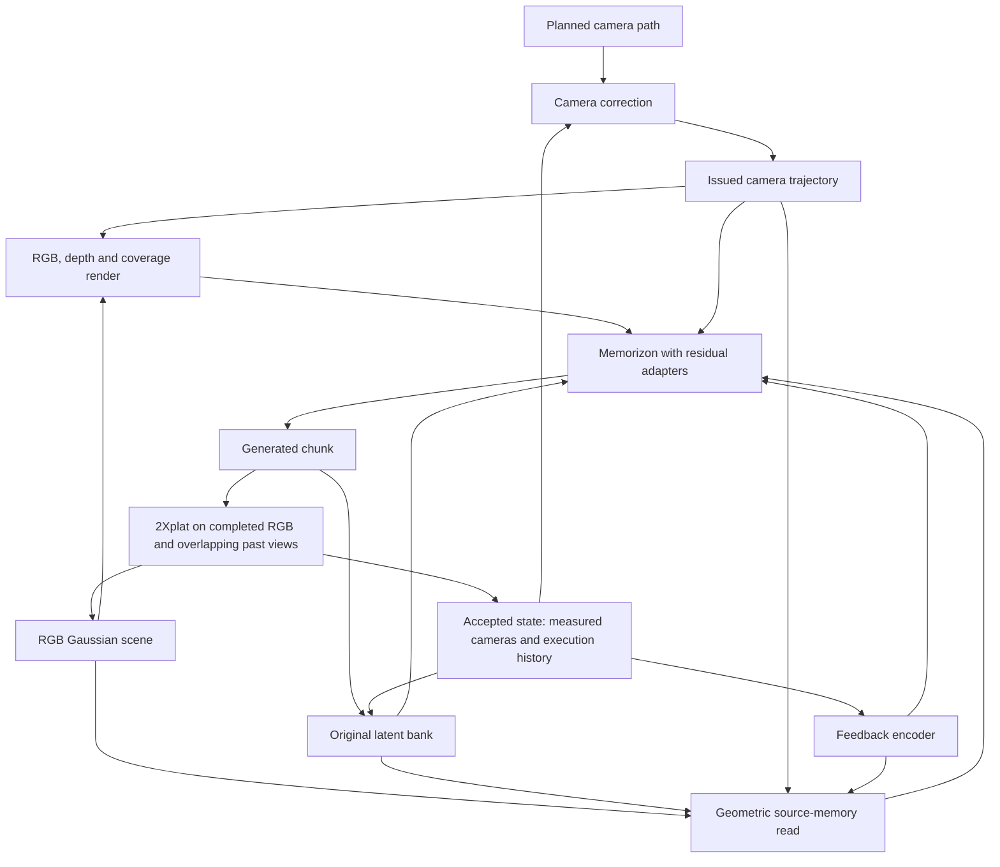

# GaussVerse: execution-aware Gaussian memory for camera-controlled generation

**Current decision after the 5 November experiments:**
[DESIGN_AFTER_DRIFT_TESTS_20261105.md](DESIGN_AFTER_DRIFT_TESTS_20261105.md).
It supersedes the architecture and schedule below: retain DA3 + ReSplat after
2Xplat's generated-history gate failed; qualify recent-overlap pose registration;
train long-prefix recovery and self-augmentation from the existing checkpoint;
evaluate the restricted reader as a separate addition. The text below preserves
the earlier design and its reasoning, rather than describing the current plan.

**Consolidated design, 5 November 2026.** This is the implementation and experiment
specification for the proposed Memorizon-based model. It is not a report of a
trained model or verified novelty. It supersedes the earlier architecture and
budget suggestions in this directory where they conflict. The available budget
is approximately **72 GPU-hours**, including preparation, generation and scoring.

The [preference audit](PREFERENCE_AUDIT_20261105.md) records the evidence behind
this revision. Restricted geometric reading and realistic imperfect histories
have supporting ablations in related systems. Our explicit execution embedding,
adapter capacity and weighted-FM reward remain hypotheses. Existing research code
already implements part of the pipeline; Section 12 distinguishes it from proposals.

**Follow-up verification:** [implementation review](REVIEW_VERIFICATION_20261105.md).
The new restricted gr reader exists and its CPU tests pass, but evaluation does
not yet supply its correspondences. Interior poses affect the trained ray branch.
Use the adapted `run_op/meas` lineage as the pilot starting point, subject to
qualification; do not interpret the schedule below as a requirement to restart.

## 1. Objective and contribution hypothesis

Generate a coherent scene along a requested camera trajectory over multiple
chunks, including departures, revisits and recovery from camera-execution errors.
The model should preserve appearance while using reconstructed geometry to place
content correctly. Some difficult-scene failures are acceptable; systematic unit,
timestamp, supervision or cache errors are not.

The proposed system is **Gaussian memory with measured-state camera correction**:
measure generated cameras, write memories in the measured frame, reconstruct from
accepted observations, correct the next camera request, and train on compatible
recovery examples from this loop. Measured placement and imperfect-history
training already have prior art. Explicit execution-history conditioning is a
secondary matched experiment, not a prerequisite or the headline contribution.

The secondary feedback hypothesis is that memory may be read differently depending on
both geometric support and recent control execution. A camera that is lagging,
accurately recovering, or poorly observed can require different use of the same
scene evidence. Explicit feedback may make this distinction easier to learn.
This is not guaranteed: measured cameras and issued commands already encode some
of these relationships. A matched comparison must establish the incremental gain.

We do not claim novelty for Gaussian memory, measured geometry, cross-attention,
flow matching, camera rewards, or their names. A useful combination is not by
itself evidence of a new scientific mechanism.

## 2. Fixed model choice and scope

| Component | Decision | Trainable in the first run? |
| --- | --- | --- |
| Generator | Adapted undistilled Memorizon lineage, retaining native camera conditioning and latent bank | Preserve the qualified continuation trainable scope; no automatic adapter-only restart |
| Reconstructor / observer | Frozen 2Xplat, exposing context-derived poses, geometry and RGB-renderable Gaussians | No |
| Structural condition | Rendered RGB encoded with the native VAE, plus depth, coverage and support | Small conditioning encoder and residual adapters |
| Appearance memory | Source VAE features with restricted geometric reading; native Memorizon bank retained | Small source-read projections and residual outputs |
| Execution feedback | Past planned/issued/measured poses, validity, age and support | Small MLP and adapter modulation |
| Camera correction | Explicit deterministic controller issuing the next trajectory from accepted measured state | No learned inverse controller in this run |
| Reward refinement | Conditional weighted-FM versus uniform-replay pilot | Same adapters; no new large policy network |

The scene remains RGB-renderable. We do not train a new latent-Gaussian codec,
Gaussian self-attention network, or learned pose/map updater in this budget. Native
latents retain source appearance; Gaussian reconstruction supplies structure and
addresses for reading those sources. This is a hybrid memory, not an RGB-only
history bottleneck.

RGB rendering is retained for structure and implementation reuse, not because it
is proven the best appearance representation. [RobustDreamer Table 3](https://arxiv.org/html/2605.30855)
favors latent over RGB memory; [L3G-World Tables 3–4](https://arxiv.org/html/2610.40614)
support learned feature lifting/refinement with mixed downstream metrics. These
motivate preserving source features, but do not establish that our hybrid beats
latent splatting. A learned scene updater is deferred for budget reasons.

[2Xplat](https://arxiv.org/abs/2603.21064) separates pose/geometry estimation from
Gaussian appearance prediction. We use it as a frozen component, not as an
original contribution. Its internal geometry machinery does not make scale,
pose conventions or causal input selection automatic.

## 3. State and coordinate contract

Maintain three separate camera streams at RGB-frame timestamps:

| Symbol | Meaning | Allowed use |
| --- | --- | --- |
| P | Original planned trajectory | Task goal and whole-system tracking evaluation |
| U | Commands actually issued to the generator | Target-camera conditioning and execution reward |
| M | Independently measured realized cameras | Memory labels, feedback and registration |

Every memory entry records its RGB/latent identity, source timestamps, camera
convention, gauge and scale, pose provenance, producer checkpoint and pose/map
version. All source poses are camera-to-world in one documented OpenCV convention
before native encoding. Native Memorizon unit conversion remains explicit.

Both the native bank and Gaussian memory use accepted M for generated history.
Retrieval, attention camera transforms and the per-chunk context KV construction
must consume the same snapshot. Changing a camera label after building a
camera-conditioned KV cache is invalid. A revised pose/map snapshot invalidates
its dependent cached projections and renders; historical issued commands remain
immutable.

2Xplat may return a locally normalized reconstruction. Register it to the existing
scene using shared observations and geometry, not by fitting its motion to U or P.
The initial anchor defines the world gauge; it need not remain visible. Use recent
overlap and retained keyframes for later windows. First qualify the existing
bounded-keyframe global reconstruction; persistent local submaps are a later
optimization. Preserve each reconstruction's transform and render view-dependent
appearance in its original basis. See the existing [coordinate contract](../gaussverse_method_design_20261104/BACKEND_CONTRACT.md).

An arbitrary reconstruction gauge is not automatically metric. Establish the
anchor-to-native scale using independently supported calibration, then update
local registration from observed overlap. Do not silently use scale 1. If scale
or registration is unobservable, mark that spatial state unavailable; do not
invent a globally measured pose. Native image-only startup can proceed before a
usable spatial map exists, but a failed required measurement later must follow
an explicit retry/stop policy rather than writing commands as measurements.

Setting anchor median depth to one defines an arbitrary gauge, not metric depth.
Overlap registration preserves that gauge but cannot infer its metric conversion.
If the chosen checkpoint requires metric-native units, qualification must identify
the independent scale source and its uncertainty; otherwise that contract remains
unresolved. The research checkpoint's recorded `scale_mult=2` is a lineage-specific
encoding convention, not a universal calibration or a knob to replace silently.
Single-anchor reconstruction also needs an explicit supported startup path:
zero camera extent cannot be normalized away. Only causal observations may update
calibration. Recorded future trajectories are never rollout calibration inputs.

## 4. Architecture

The diagram describes dependencies across chunk boundaries, not simultaneous
access to the next chunk's measured poses.

### 4.1 Structural read

Render the current accepted scene along U for the next chunk. Encode rendered RGB
with a separate native-VAE encoder state; add depth, coverage and geometric-support
channels. Preserve the generator's streaming decoder state. A small residual
branch injects these features into selected transformer blocks.

Coverage means that a surface projects there; it is not proof the surface is
correct. Support summarizes observed agreement and provenance, not a calibrated
probability unless calibration is actually performed. Missing or disputed geometry
reduces the structural contribution. The native generator still fills unobserved
regions. Never mask such regions out of the target generation loss.

### 4.2 Original-source appearance read

Queries come from noisy target tokens. Keys and values come from a bounded subset
of source VAE features, preserving observed appearance. Geometry
projects source surface support into U, providing correspondence and visibility.

A schematic added attention read is:

\[
 a_i=\sum_{j\in\mathcal N(i)}
 \operatorname{softmax}_j\left(q_i^\top k_j/\sqrt d+b_{ij}\right)v_j.
\]

N is explicitly restricted to geometrically corresponding, visibility-compatible
source candidates. Attention learns weights within that set; b may add support
information within it. This revises the earlier ambiguous recommendation for soft
geometric influence: do not make every history token accessible to this branch
with only a weak geometric bias. This is a design equation, not a claim that a
particular sparse kernel is already implemented. Keep native attention intact,
and profile gathered/local attention separately.

For uncertain correspondences, a bounded footprint neighborhood may supply
multiple plausible candidates. Do not expand to unrestricted history. If none are
supported, return zero from the added read and leave native attention/generation
available. Record candidate coverage and rejection rather than hiding empty reads.
Occlusion filtering and multi-view alternatives remain part of the design.
Temporal VAE tokens cover multiple RGB frames and spatial neighborhoods: represent
their projected footprints, not a fictitious one-token/one-3D-point identity.

**GEAR ablation review:** [Section 4.3, Table 2](https://arxiv.org/html/2609.34722#S4.T2)
compares the same attention module/parameter count with dense versus restricted
access and favors restriction. Its correspondence-disturbance test retains valid
matches. Appendix A.2 uses framewise VAE encoding. These findings motivate our
restricted auxiliary read, but do not validate its transfer to Memorizon.

Preserve Memorizon's main temporal codec. First qualify the implemented temporal
token reader's endpoint-address approximation on recorded motion and occlusion.
Separately encoded source keyframes and target-footprint aggregation are possible
remedies if that audit finds a material failure, not mandatory changes before the
pilot. Current gr restricts access with dense masks; it does not gather sparse
keys. This is not an exact GEAR reproduction. Report empty-read coverage and GPU
cost. Do not relabel gb's soft bias as restriction.

Qualify the implemented gr capacity first: CameraBranch compresses width by eight
and inserts a reader every second block (width 384 for the 3072-wide checkpoint).
The earlier width-128/four-insertion suggestion was an untested engineering choice,
not a requirement to replace existing work. GEAR does not validate our capacity.
Initialize residual output projections to zero; do not multiply two permanently
zero branches in a way that prevents either receiving a gradient.

### 4.3 Execution-history conditioning

At an accepted boundary k, compute in the measured local frame:

\[
 e_k^{plan}=\log(M_k^{-1}P_k),\qquad
 e_k^{exec}=\log(M_k^{-1}U_k).
\]

Each is a six-dimensional SE(3) residual. Preserve translation and rotation as
separate quantities. Normalize translation using the established scene gauge,
not a near-zero planned step. Use consistent rotation units. Encode up to three
past boundaries, relative motion, measurement validity, observation age and support.
Transport historical residuals consistently before comparing them across frames.

A small MLP produces residual modulation for the added camera and memory branches.
The source-read contribution has the form

\[
 h_i'=h_i+g_\theta(h_i,e_{\le k},s_i)\,W_o a_i
       +\text{structural residual}_i,
\]

where s is local support. Large task error must not automatically imply unreliable
geometry. The model should learn the distinction between control state and
measurement quality. Keep the last accepted feedback fixed during the next
chunk's denoising; no future measured outcome enters its conditioning.

U is the single authoritative next camera request. This branch provides execution
context, not a second displacement added to the controller's correction. Passive
execution ratios are observations, not identified differential response gains.

Clean recorded videos have no historical generator command ledger. Mark execution
feedback unavailable for them. Do not interpret the difference between recorded
poses and noisy estimated poses as generator execution error. Actual nonzero
execution feedback is learned from generated histories.

### 4.4 Reconstruction updates and correction

Reconstruct completed chunks with bounded overlapping accepted views, register
proposals, and retain source associations. On revisits, use supported
old observations to check the new reconstruction. Assess updates on past views
not used for fitting when enough observations exist. Source lineage matters:
multiple generated frames copying the same error are not independent confirmation.

The existing global wrapper needs old-camera refit residual checks before commit.
Cache keys must include scene, selected RGB identities, pose/gauge versions and
reconstructor identity, not frame indices alone. Endpoint observations do not
establish full-rate measured rays: measure the required RGB poses or explicitly
validate and label interpolation and missing support. Never mix recorded interior
poses with measured endpoints while describing the whole sequence as measured.

For this run, reconstruction improvement comes from better inputs, registration,
refresh and rejection of unsupported updates. Do not describe this as a trained
scene-repair network or claim an accuracy gain before measuring it. Unseen content
is plausible completion, not recovery of an unknowable true hidden scene.

Use one versioned correction policy in training collection and evaluation. Its
initial candidate is the existing rejoin policy, subject to adapter/unit checks.
Record clipping, lag and rejected measurements. Do not silently introduce another
future-speed or gain-learning controller during the comparison. Feedback learned
by the generator and external correction must be evaluated together for oscillation.

## 5. Inference algorithm

1. Read the accepted prefix, measured camera snapshot, source bank and local map.
2. Form causal feedback from available P/U/M history. Mark unavailable fields.
3. Issue the next U using the fixed controller; record it before generation.
4. Render structural evidence and prepare geometric source reads from past data.
5. Rebuild native camera-conditioned context and generate one chunk.
6. Reconstruct/measure the completed chunk with overlapping historical views.
7. Validate registration and scene support. Retry on the same RGB with additional
   past support when useful; do not resample until a favorable measurement appears.
8. Commit accepted measured labels to both memories, invalidate stale derived
   caches, and update feedback. On unresolved failure, preserve the pending chunk
   and explicit failure record; never claim it was an accepted continuation.

The full controller/observer runs at chunk boundaries. This design does not add a
pose-estimator call at every denoising step.

## 6. Training objective: flow matching

Start from an **undistilled Memorizon teacher**. Preserve native per-query-chunk
noise sampling, clean prefix masking, timestep weights and camera conventions.
For the illustrative noise parameterization

\[
 z_t=(1-t)z+t\epsilon,\quad \epsilon\sim\mathcal N(0,I),
\]

train

\[
 \mathcal L_{FM}=\mathbb E\left[
 w(t)\|v_\theta(z_t,t;c)-(\epsilon-z)\|_2^2
 \right]_{\text{target tokens}}.
\]

c contains text, issued target cameras, measured prefix cameras, native history,
structural evidence, source features and past feedback. In code, call the existing
scheduler's noise/target/weight methods; its velocity target is noise minus sample.
Do not substitute another paper's time direction or timestep weighting.

There is **no final-output image/latent L1 generator objective**. Flow-matching MSE
regresses a velocity under noise; it is not direct final-image regression. The
frozen VAE, observer and reconstruction are initially detached. Gradients train
the structural encoder, source reader and feedback modulation. Lowering a frozen
observer's error is not an implicit differentiable training path.

Continue the qualified `run_op/meas` checkpoint and its native training recipe,
recording the exact trainable scope and learning-rate groups. It already updates
a Memorizon backbone subset plus conditioning branches; it is not adapter-only.
New reader parameters may use their declared separate rate. Keep FP32 trainable
state, BF16 base computation, clipping and checkpointing consistent with the
qualified recipe. Save trainables/optimizer/RNG/sampler state and a hashed base
identity rather than duplicating full frozen weights. A frozen-base adapter-only
restart is an alternative experiment, not the deadline default.

These optimizer/capacity values are profiling defaults, not ablation-backed optima.
Any capacity or LoRA change must be shared by both matched continuation arms.

## 7. Data and supervision contract

Use scene-disjoint train, development and final-test manifests from our dataset.
Verify RGB timestamps, intrinsics after resizing/cropping, latent temporal support,
camera gauge and native preprocessing. The local teacher config is 1280x704;
480p adaptation must be qualified explicitly rather than assumed compatible.

Sample moving paths, turns, departures, genuine revisits and stationary controls.
Choose history span by actual revisit coverage rather than maximizing duration;
Memorizon's span ablation shows saturation and quality tradeoffs. Keep scene
diversity and a bounded retrieved bank.
Training history should reach the earlier observation without densely tokenizing
all intervening frames. Only past images enter reconstruction and memory selection.
Fixed training inputs may be cached; generated-history records carry producer
checkpoint and pose/map versions. Calibration is causal and image-derived;
caching an identical prefix computation is not advance rollout calibration.

| Record type | Conditioning and target | Meaning |
| --- | --- | --- |
| Recorded video | Causally measured prefix; target RGB/latents with compatible recorded target cameras | Real-data FM supervision; execution-history fields unavailable |
| Recovery to recorded camera | Generated prefix; query explicitly set to recorded target camera P; compatible recorded future | Changed-query recovery replay, not necessarily deployed controller U |
| Camera-compatible recovery | Actual generated prefix and U; genuine compatible future observations or qualified teacher samples at U | Recovery supervision; teacher samples explicitly labeled synthetic |
| Reward replay | Actual generated prefix, U, sampled generated target, measured outcome M and score | Reward-weighted self-training; not recorded ground truth |

Correction changes U. Existing recorded pixels at another camera do not become
valid targets by relabeling. Keep the recorded-target camera guard. A separate
generated-replay schema records that a sample was produced under U but realized
M; reward-weighted learning favors useful samples without asserting M equals U.
The target's measured outcome can determine its training weight, but cannot enter
its conditioning. It becomes history only for a subsequent chunk.

Real-data targets may enter the loss but never the preceding observer, map or
retrieval input. Teacher samples are checked for quality and pose compatibility;
a low-quality teacher cannot provide unquestioned truth for unknown surfaces.

After a short clean warm-up, mix realistic imperfect histories with recorded
examples. RobustDreamer's deviation ablation supports this type of exposure, not
our exact mixture or timing. Check prefix/target appearance compatibility; preserve
producer and query provenance. A frozen history pool is replay, not continuously
on-policy training. Refresh it once within the collection budget when feasible.

## 8. Camera reward and limited reward-weighted FM

This mechanism is unverified. [CamVerse](https://arxiv.org/html/2512.02870) and
[Geo-Align](https://arxiv.org/html/2605.23903) use GRPO; their gains do not establish
that two-candidate weighted imitation is effective. Run only if candidate scoring
and matched weighted/uniform continuations fit the reserve. Otherwise spend it on
ordinary recovery FM and omit a reward-improvement claim.

This is a small post-adaptation pilot, not a prerequisite for a useful initial
teacher. Reward **execution of U**, while scoring whole-system tracking against P
separately. Start a recovery comparison from the accepted measured boundary;
do not charge the next chunk for inherited error it was not commanded to remove.

Construct an interpretable score from:

- Translation discrepancy, including magnitude and direction, in the fixed scene
  gauge; no trajectory-scale fit to the generated motion.
- Rotation discrepancy at corresponding timestamps.
- Multiple interior motion intervals and the endpoint, so a zigzag cannot hide
  behind a correct endpoint. Requested turns/reversals are not penalized merely
  for changing direction.
- Preservation of supported old scene content and visual quality. Do not score
  unseen appearance against a fictional ground truth.

A schematic score is r=-lambda_t E_t-lambda_R E_R-lambda_path E_path-lambda_scene
E_supported, with a separate visual-quality eligibility check. Define each error
in documented units and freeze global weights/thresholds after development
qualification. No model-specific motion multiplier is needed. Availability and
observer failures are explicit; confidence alone is not a reward for correctness.
Independent pose/visual evidence is needed to audit a reconstructor scoring its
own outputs. Lost tracking cannot be treated as zero error.

Generate initially two candidate chunks from the same prefix, text, U and memory
snapshot using different noise seeds. This is training-only sampling; evaluation
uses the predeclared seeds with no best-of selection. Compare rewards only when
measurement support and quality permit. If differences are below estimated
measurement uncertainty, do not manufacture a confident ranking.

For comparable samples, compute detached bounded within-group weights, e.g.

\[
 a_i=\operatorname{clip}\left(
 \frac{r_i-\bar r}{\max(s_r,s_{obs})},-2,2\right),\qquad
 w_i=G\,\operatorname{softmax}_i(a_i/\tau).
\]

s_obs is a development-calibrated reward uncertainty scale; it is not inferred
from one observer refit. G is the comparable candidate count. With no meaningful
ranking use uniform weights; with no usable group skip its reward update and
record the failure. Do not compare unrelated scenes through one reward softmax.

Fit generated target latents with weighted FM while retaining real-data FM:

\[
 \mathcal L=(1-\eta)\mathcal L_{FM}^{real}
       +\eta\frac1G\sum_i \operatorname{stopgrad}(w_i)
                         \mathcal L_{FM}(z^{gen}_i,c_i).
\]

Start the short pilot with eta=0.25 and tau=1 as declared provisional settings,
not validated constants. Preserve pre-reward weights for comparison. This is
reward-weighted self-training, **not GRPO, DMD or an unbiased policy gradient**.
Merely adding a detached scalar reward to FM would not train the model. Weighted
imitation can reinforce artifacts, so visual qualification and a real-data mixture
are necessary, and improvement remains empirical.

The local score does not establish long-term memory quality. Evaluate subsequent
chunks and revisits; a future multi-chunk reward is outside this first pilot.

## 9. Training sequence and 72 GPU-hour allocation

The original 6/42/12/8/4 total is retained, with realistic-history collection moved
earlier. The 42 FM hours include one matched feedback control. Eight collection
hours and a four-hour conditional reserve occupy the 12 recovery hours. This is
one architecture and a small mechanism comparison, not a representation search.

| Order | Work | GPU-hours | Output |
| --- | --- | ---: | --- |
| 1 | Qualification and compact preprocessing | 6 | Verified causal path, zero-output parity, backward/save/reload, measured throughput |
| 2 | Integration/warm-up allowance from the adapted checkpoint | 6 | Qualify new inputs/reader; skip redundant clean adaptation and reassign unused time to paired evaluation |
| 3 | Early generated-history collection | 4 | Compatible recovery examples with actual history P/U/M and query provenance |
| 4 | Common mixed-history FM | 24 | Shared robust-memory checkpoint; no explicit execution embedding yet |
| 5 | Refreshed recovery collection and scoring | 4 | Replay from the shared checkpoint, with compatible targets |
| 6a | Feedback-conditioned recovery continuation | 6 | Main candidate |
| 6b | Matched continuation without explicit execution embedding | 6 | Same parent, examples, cameras, correction and read architecture |
| 7 | Conditional reserve | 4 | If qualified: 2h weighted + 2h uniform replay from the same main parent; otherwise ordinary recovery FM |
| 8 | Held-out rollout evaluation | 8 | Paired quality, motion, revisit and failure report |
| 9 | Contingency | 4 | Targeted fault recovery |
| | **Total** | **72** | |

Match optimizer-update counts, data order, trainable-module capacity and sampled
noise for 6a/6b as far as possible, with the same update count fitting the slower
arm's time allocation. In 6b keep ordinary support/age information and measured
poses; mask only the explicit tracking/execution-history embedding. This tests
feedback beyond the existing measured-pose and command inputs. The frozen common
producer makes this first comparison generated-history replay, not continuously
on-policy training. Report any refreshes and their cost explicitly.

This control does not isolate the geometric attention mechanism itself. A fully
matched ordinary-attention comparison is a later paper requirement if we claim
an independent attention contribution. If reward is run, use identical candidates,
update counts and real-data mixtures for weighted and uniform replay. Account for
sampling/scoring in the reserve: if it leaves too few updates, defer reward rather
than omit the control. If the reserve becomes ordinary FM, retain the matched
6a/6b snapshots; extra training must not contaminate that comparison.

GPU sampling, 2Xplat calls, VAE preparation, interim previews and evaluation all
count. CPU implementation and waiting behind existing jobs are separate wall
time. Fixed hours do not guarantee sufficient updates: set step counts from actual
throughput and save them in the run manifest. If preparation or sampling cannot
fit, diagnose before spending the main budget; do not hide missing stages under
the full-method name. Prioritize the useful teacher and evaluation over the
optional reward stage. Four-step distillation is deferred.

## 10. Evaluation and claim-specific controls

Freeze a development panel before training, containing moving trajectories,
revisits outside recent context, loss of anchor visibility, weak geometry and
stationary scenes. Determine its affordable scene/seed count after profiling;
two seeds are an initial qualification minimum, not evidence of statistical power.
Use a separate scene-disjoint final test. Report per-scene pairs and dispersion,
not only aggregate averages.

| Comparison | Question answered | Limitation |
| --- | --- | --- |
| Native Memorizon vs common adapted model | Does the complete adaptation help? | Data adaptation and memory addition are confounded without matched native-only training |
| Main vs matched no-feedback continuation | Does explicit execution conditioning add value? | Secondary mechanism test, after the memory/reader path qualifies |
| Memory/source-read/feedback disabled at inference | Does the trained model rely on the supplied evidence? | Intervention diagnostic; not a training ablation |
| Corrected vs uncorrected rollout of the same checkpoint | Does external correction help this trained model? | Changes rollout state distribution |
| Measured vs commanded history labels | What is the effect of memory pose labels? | Report geometry/retrieval changes as part of the intervention |
| Weighted vs uniform replay, if qualified | Does reward weighting help beyond replay? | Small optional pilot; both compared to their shared parent |
| Matched generic reader / native-only | Establish individual memory and attention claims | gr versus gb alone changes capacity; allocate before claiming restriction itself causes gains |

Measure fixed-timestamp execution against U and task tracking against P separately.
Report rotation, translation, requested versus realized motion, oscillation and
boundary discontinuity, coverage, supported revisit consistency, appearance and
scene survival. Evaluate reconstructed scenes on withheld views where references
exist. Do not time-warp or fit a per-rollout scale that removes execution error.
Keep these fixed-gauge results distinct from literature camera metrics using
trajectory Sim(3) alignment; they answer different questions.

Use an independent observer where feasible and inspect RGB videos; finite poses
do not establish scene survival. Report rejected measurements, unregistered chunks,
collapse and incomplete runs in the denominator. Generated novel regions can be
evaluated for coherence and plausibility, not nonexistent real-view pixel accuracy.

## 11. Novelty relative to related work

The table describes the reviewed mechanisms, not exhaustive negative claims about
every paper or an independently reproduced ranking. Concurrent methods remain
relevant references. Differences below are proposals until our experiments verify
them; using different pretrained components is not the central distinction.

| Reference | Established mechanism | Our proposed emphasis / required distinction |
| --- | --- | --- |
| [Memorizon](https://arxiv.org/html/2610.00544) | Bounded camera-based latent retrieval and long-span training | Retain this foundation; test execution-conditioned spatial reading beyond native camera-conditioned retrieval |
| [2Xplat](https://arxiv.org/abs/2603.21064) | Feed-forward pose and Gaussian reconstruction using separate geometry/appearance experts | Frozen reconstruction component; replacement of a reconstructor is not a novelty claim |
| [Robust Dreamer](https://arxiv.org/html/2605.30855) | Image-inferred global geometry with inherited latent Gaussian memory and archived deviations | Test explicit observer-driven command correction and recovery from its states; measured placement and imperfect-history training alone are not distinctions |
| [L3G-World](https://arxiv.org/html/2610.40614) | Latent Gaussian memory with learned spawning/refinement and memory-conditioned generation | We do not claim a better learned Gaussian updater; test control-aware use of measured scene state |
| [WorldStereo](https://arxiv.org/abs/2603.02049) | Global geometric memory and correspondence-guided appearance attention | Geometric memory reading is shared prior art; the incremental question is execution feedback during recovery |
| [GEAR: Geometry as Address](https://arxiv.org/abs/2609.34722) | Restricted geometric memory attention; dense-attention and disturbance ablations | Adopt restriction as prior art; test measured execution feedback beyond this stronger reader, with explicit temporal-codec qualification |
| [GLIMPSE](https://arxiv.org/abs/2610.13706) | Geometry-dependent precision for projected memory addresses, with global/local memory | Uncertainty-aware routing is established; distinguish execution state from correspondence uncertainty |
| [CamVerse](https://arxiv.org/html/2512.02870) | Segment-relative geometry rewards and online RL camera-control post-training | Camera reward is established; ours is a small weighted-FM replay pilot in a measured-memory correction loop, not equivalent RL |
| [Geo-Align](https://arxiv.org/html/2605.23903) | Scale-aware camera and visual-quality rewards for video re-rendering | Metric motion fidelity and preserving quality are established goals; persistent recovery/memory behavior is our test setting |

Other useful context is catalogued in [the earlier research review](RESEARCH_AND_DESIGN.md),
including Lyra 2.0, Mirage, MosaicMem and geometric mapping methods. Those references
also rule out broad first claims for feature routing or joint pose/map handling.

### Defensible candidate claim

> We investigate camera-controlled generation with Gaussian memory, measured-state
> command correction and recovery training from the resulting histories. Matched
> experiments test how reconstruction updates and geometric reading affect
> tracking, appearance and revisits. Explicit execution embeddings are evaluated
> separately beyond measured-pose memory and command correction.

This wording describes the intervention without claiming an outcome. After matched
results, replace "tests whether" with the measured effect and its scope. Reward
refinement is a secondary training experiment unless its own control supports a
stronger claim.

The main reviewer risk is that the system combines known parts without an isolated
mechanism gain. Matched controls must address this; feedback alone is not a remedy.
The explicit feedback embedding may duplicate camera information. If it does not help, report the
useful simpler system and revise the claim; do not rename the embedding to imply
novelty. Better reconstruction is another empirical endpoint, not guaranteed by
using Gaussian memory. No CVPR acceptance or exhaustive priority claim is made.

## 12. Implementation readiness and delivery order

Two implementation lines exist. The earlier readiness review covered only the
cleaner repository and missed the research implementation; that was incomplete.

| Implementation | Existing pieces | Gaps relative to this design |
| --- | --- | --- |
| `measured-gaussian-memory` | Native latent bank, RGB/ReSplat condition, DA3 measured writes, rejoin correction | Its Gaussian pilot is final-output L1; its separate native FM launcher excludes Gaussian checkpoints; substantial preexisting edits |
| `analysis/plan_base_restart_20261008/fresh_teacher_20261021/` | Gaussian FM, 2Xplat memory, corrected-history replay, adapted Memorizon-50, gb bias and new gr hard-masked reader | Sampling does not pass corr; mixed interior/end poses affect the ray branch; temporal correspondence and GPU cost remain unqualified |

The [existing pilot plan](PILOT_PLAN_CVPR_20261104.md) describes the research route.
Its `run_op/meas/ckpt/trainables_00250.json` records an adapted checkpoint and native
scale convention. Metadata inspection does not verify weights, runtime or quality.
Prefer auditing and reusing this work over rebuilding it. Its frozen pool queries
recorded future cameras after collecting corrected prefixes: label that recovery
to recording, not proof of deployment-command supervision. Existing dense-bias
experiments remain a separate baseline. Neither implementation yet establishes
the complete restricted-reader/feedback design above.

Implement in this order:

1. Verify the undistilled checkpoint lineage, resolution/preprocessing and data
   units; preserve all protected models and existing jobs.
2. Wire causal correspondence construction through pack, denoise and both CFG
   forwards before evaluating gr/gb. Verify a nonzero reader is actually used.
   Qualify the existing context-only 2Xplat wrapper: startup, native-unit scale,
   overlap registration, full-rate labels and versioned cache invalidation.
   Exclude any benchmark path that estimates cameras from future target RGB.
3. Audit/reuse the existing Gaussian FM route against native scheduler targets and
   weights, and fix the causal measured-history/query-target contract. Assert that
   the branch participates in training; do not port its old dense bias as GEAR.
4. Qualify the implemented restricted reader's temporal endpoint addresses,
   empty geometry and nonzero trained behavior. Defer gathered kernels/separate
   source encoding unless profiling or correspondence errors justify them.
   Add execution-feedback fields only for the secondary matched arm.
5. Verify full-rollout zero-adapter parity, native timestep/velocity agreement,
   no future leakage, timestamp/unit agreement, real backward, memory peak,
   adapter save/reload/resume and cache invalidation.
6. Prepare immutable manifests and start the qualified curriculum when GPU space
   is available. Profile disk needs before caching; existing low free space does
   not authorize deleting protected checkpoint dependencies.
7. Add reward replay only after the observer's rankings and visual criteria are
   usable. Keep training-only candidate selection out of reported test generation.

No implementation, queue insertion or training launch is performed by writing
this document. Resource readings in earlier notes are snapshots, not current
availability. The deliverable of this planning task is the consolidated design,
bounded experiment schedule and explicit novelty/evidence comparison.
